# 성경맥잡기 — 가르치는 방식 (선생님 말씀 정리)

> 선생님이 불러 주신 것을 순서대로 받아 적고 풀어 둔다.
> 「풀이」는 정리하는 쪽의 이해이고, **(확인)** 이 붙은 것은 아직 확인받지 않았다.

## 여는 고백

**성경은 하나님의 말씀이다.**

## 성경 전체

**신구약 총 66권이 있다.**

## 맥점 1 — 3 × 9 = 27 (구구단)

**구약 39권, 신약 27권을 이렇게 외우는 것이 성경공부의 첫 번째 맥이다.**

- 구약은 **39**권 → 숫자 **3**과 **9**
- 그 둘을 곱하면 **3 × 9 = 27** → 신약은 **27**권
- 39 + 27 = **66**권

## 맥점 2 — 약(約)은 약속이다 **(확인 — 맥점 2 가 맞는지)**

**구약·신약의 「약」은 약속할 때의 약, 곧 언약이다.**
구약은 옛 약속, 신약은 새 약속이라는 뜻이다.

**그 약속의 중심에 예수 그리스도께서 계신다.**

| | 약속 |
|---|---|
| **구약** (옛 약속) | 하나님의 아들 **메시야가 오실 것이다** |
| **신약** (새 약속) | 그 오실 메시야가 **예수님이시다** — 십자가에서 죽으시고, 부활하시고, **다시 오실 것이다** |

- 풀이: 맥점 1 이 성경의 **크기**(39 · 27 · 66)를 잡는다면, 맥점 2 는 성경의 **중심**(예수 그리스도)을 잡는다.

## BC 와 AD **(확인 — 맥점 2 에 이어지는 설명인지)**

**예수님의 탄생을 중심으로 인류의 역사가 나뉜다.**

| | 원말 | 뜻 |
|---|---|---|
| **BC** | Before Christ | 그리스도 이전 — 예수님 오시기 전 |
| **AD** | Anno Domini (라틴어) | 주님의 해 |

- 덧붙임 **(확인 — 수업에서 다루실지)**: 6세기 수도사 디오니시우스가 연대를 계산할 때
  몇 해 어긋나, 실제 탄생은 **약 BC 6–4년**으로 본다(헤롯 대왕이 BC 4년에 죽었는데
  예수님은 그 전에 나셨다 — 마 2:1, 19). 「예수님이 BC 에 태어나셨다고요?」 하는
  질문이 나올 때 쓸 수 있다. 교재 2과에도 이 연대가 들어 있다.

## 구조를 먼저 잡는다

**먼저 성경의 구조를 파악해야 한다.** 어떤 내용이 담겨 있고 어떻게 구조화되어 있는지를
알아야 성경을 배우기가 쉽다.

그래서 먼저 간단하게 **신약부터** 본다.

> **질문 — 신약 27권은 어떤 내용으로 이루어져 있는가?**

## 맥점 3 — 신약의 구조

**이게 전부다.**

| 묶음 | 권수 | 책 |
|---|---|---|
| **4복음서** | 4 | 마태복음 · 마가복음 · 누가복음 · 요한복음 |
| **사도행전** | 1 | 사도행전 |
| **바울서신** | 13 | 로마서 – 빌레몬서 |
| **비바울서신 (공동서신)** | 9 | 히브리서 – 유다서 8권 + **요한계시록** |

### 역사서 5권 — 4복음서 + 사도행전

- **4복음서**: 마태복음 · 마가복음 · 누가복음 · 요한복음
- 그리고 **누가복음의 후속편, 사도행전**
- **이 5권이 역사서가 된다.**

> 덧붙임 (근거 구절): 사도행전이 누가복음의 후속편이라는 것은 두 책 모두 「데오빌로」에게
> 쓴 데서 드러난다 — 눅 1:3, 행 1:1(「내가 먼저 쓴 글에는…」).

그래서 신약은 세 묶음이다 — **역사서 5 · 바울서신 13 · 비바울서신 9 = 27**.
요한계시록도 비바울서신에 들어간다(일곱 교회에 보낸 편지, 계 1:4).

## 바울서신 13권

### 교리서신 — 로마서 · 갈라디아서

- **로마서**: 유명한 책. 기독교의 중요한 **교리를 정리**한 것이다.
- **갈라디아서**: 「**로마서의 동생**」이라고 불린다.
- 두 권의 주제가 같다 — **이신칭의(以信稱義)**, 믿음으로 말미암아 의를 얻는다.
  **하나님의 백성이 되는 방식**을 다룬다.
- **이 두 권을 「교리서신」이라고 부르자.**

> 덧붙임 (근거 구절): 롬 1:17 「오직 의인은 믿음으로 말미암아 살리라」 · 갈 2:16
> (율법의 행위가 아니라 그리스도를 믿음으로 의롭게 됨). 두 책 모두 아브라함이 믿음으로
> 의롭다 함을 받았다는 같은 예를 든다(롬 4장, 갈 3장).

### 옥중서신 4권 — 「에 · 빌 · 골 · 빌」

- 바울이 **로마 감옥**에 갇혀서 쓴 편지 4권.
- 외우기: **에 · 빌 · 골 · 빌** — 에베소서 · 빌립보서 · 골로새서 · 빌레몬서

> 덧붙임 (근거 구절): 넷 모두 스스로 갇힌 몸이라고 말한다 — 엡 3:1, 빌 1:13, 골 4:18,
> 몬 1:1. 바울이 로마에서 매인 채 2년을 지낸 것은 행 28:16, 30.

### 목회서신 3권 — 디모데전서 · 디모데후서 · 디도서

- 제자 **디모데와 디도**에게 쓴 편지.
- 바울이 **순교 전에** 쓴 편지다.

> 덧붙임 (근거 구절): 디모데후서는 바울의 마지막 편지로 본다 — 「관제와 같이 벌써 내가
> 부음이 되고 나의 떠날 기약이 가까왔도다」(딤후 4:6). 세 권의 연대는 사도행전 이후의
> 일이라 전통에 기댄다(약 AD 62–67).

### 교회서신 4권 — 데살로니가전후서 · 고린도전후서

- **교회의 문제를 해결하기 위해서** 쓴 편지.
- 두 교회 — **데살로니가**와 **고린도**. 각각 전서·후서가 있어 총 **4권**.

### 바울서신 정리 — 2 · 4 · 3 · 4 = 13

**이렇게 구분하면 바울서신 13권이 정리된다.**

| 묶음 | 권수 | 책 |
|---|---|---|
| **교리서신** | 2 | 로마서 · 갈라디아서 |
| **옥중서신** | 4 | 에베소서 · 빌립보서 · 골로새서 · 빌레몬서 (에 · 빌 · 골 · 빌) |
| **목회서신** | 3 | 디모데전서 · 디모데후서 · 디도서 |
| **교회서신** | 4 | 데살로니가전서 · 데살로니가후서 · 고린도전서 · 고린도후서 |

## 비바울서신 9권 (공동서신)

- **비바울서신**: 바울 사도가 쓰지 않고 **다른 사도들이 쓴** 서신서라는 뜻이다.
- 다른 말로 **공동서신**이라고 부른다.

### 9권 차례대로

| 책 | 누가 썼나 |
|---|---|
| **히브리서** | 확실하지 않다 — 바울이 썼다는 이들도, 바나바라는 이들도 있다 |
| **야고보서** | 예수님의 동생 야고보 |
| **베드로전서 · 베드로후서** | 베드로 |
| **요한일서 · 요한이서 · 요한삼서** | 요한 |
| **유다서** | 사람들이 잘 모를 수 있는 책. **가룟 유다가 아니라 예수님의 동생 유다** |
| **요한계시록** | 마지막 책 — 요한 |

> 덧붙임 (근거 구절): 예수님의 동생들 이름 — 「그 형제들은 야고보, 요셉, 시몬, 유다라
> 하지 않느냐」(마 13:55). 유다서는 스스로 「야고보의 형제인 유다」라고 밝힌다(유 1:1).

### 요한이 쓴 성경 — 5권

보면, **요한이 쓴 성경이 꽤 있다.**

| 묶음 | 책 |
|---|---|
| 역사서 | 요한복음 |
| 비바울서신 | 요한일서 · 요한이서 · 요한삼서 |
| 비바울서신 | 요한계시록 |

총 **5권**.

> 덧붙임 **(확인 — 수업에서 짚으실지)**: 다섯 권 모두 요한이 썼다는 것은 교회의 오랜 전통이다.
> 본문에 이름이 직접 나오는 것은 요한계시록뿐이다(계 1:1, 4, 9). 요한복음은 「예수의
> 사랑하시는 제자」가 썼다고 하고(요 21:20, 24), 요한이서·삼서는 「장로」라고만 밝힌다.

### 누가 몇 권을 썼나

- **바울 사도 13권**
- **요한 5권**

**그렇게 신약 27권이 정리된다.**

> **신약 27권은 4복음서와 사도행전, 바울서신 13권과 공동서신 9권으로 이루어져 있다.**
> (「공동서신 9권」은 아래 검토 메모 1번 참고)

---

## 검토 메모 (2026-11-10, 선생님 요청 — 틀린 것 짚기)

1. **고칠 것 — 「공동서신」의 범위.** 보통 공동서신(일반서신)은 야고보서·베드로전후서·
   요한일이삼서·유다서 **7권**을 말하고, 히브리서는 여기에 넣기도 하고 따로 두기도 한다.
   **요한계시록은 공동서신이라 부르지 않는다**(예언서로 따로 분류). 「비바울서신 9권 =
   공동서신」이라고 하면 다른 책·교재와 어긋난다.
   제안: 「비바울서신 9권 = 히브리서 + 공동서신 7권 + 요한계시록」.
2. **표기 — AD 는 Anno Domini.** (Domine 가 아님)
3. **다듬을 것 — 「다른 사도들이 쓴」.** 히브리서는 저자 미상, 야고보·유다는 열두 사도가
   아닌 주님의 형제다. 다만 바울은 주의 형제 야고보를 사도와 나란히 부른다 — 「주의 형제
   야고보 외에 다른 사도들을 보지 못하였노라」(갈 1:19). 「바울 아닌 다른 이들이 쓴」이
   가장 안전하다.
4. **보태면 좋을 것 — 야고보가 둘.** 열두 제자 야고보(세베대의 아들, 요한의 형)는 일찍
   순교했다 — 「요한의 형제 야고보를 칼로 죽이니」(행 12:2). 그래서 야고보서의 야고보는
   주님의 동생이다. 유다처럼 「이 야고보는 그 야고보가 아니다」를 짚어 주면 헷갈림이 준다.
5. **사실은 맞지만 학계에 다른 견해가 있는 것** — 틀린 것은 아니다. 옥중서신을 쓴 곳(로마가
   전통, 에베소·가이사랴설도 있음), 요한 5권 저작(전통), 목회서신 저작 시기(사도행전 이후,
   전통).
6. **분류 방식이 흔한 것과 다른 것** — 틀린 것은 아니다. 보통은 복음서 4 · 역사서 1(사도행전)로
   나누는데, 선생님은 「역사서 5」로 묶는다. 이야기로 된 책 다섯이라 가르치기에 더 쉽다.
   다른 교재를 본 수강생이 물을 수 있다.

## 신약은 언제 쓰였나 — 쓰인 순서

- 가장 먼저 쓰인 **복음서**는 **마가복음**(약 AD 55–65)이다.
- 가장 먼저 쓰인 **신약 책**은 **바울의 편지**(데살로니가전서 · 갈라디아서, 약 AD 50 전후)다.
- 가장 나중에 쓰인 책은 **요한계시록**(약 AD 95)이다.

> 처음 말씀(「가장 먼저 쓰인 신약성경은 마가복음, AD 55」)을 2026-11-10 검토 뒤 위 문장으로 고쳤다.
> 바울서신이 마가복음보다 이르고, 마가복음 연대는 대개 AD 55–70 으로 본다.

### 27권 쓰인 순서 (모두 「약」 — 복음주의 학계에서 널리 쓰는 연대)

| 연대 | 책 | 덧붙임 |
|---|---|---|
| AD 45–49 | 야고보서 | 가장 이르게 보는 견해 |
| AD 48–49 | 갈라디아서 | 남갈라디아설 (북갈라디아설이면 53–57) |
| AD 50–51 | 데살로니가전서 | 고린도에서 |
| AD 51 | 데살로니가후서 | 고린도에서 |
| AD 55 | 고린도전서 | 에베소에서 (고전 16:8) |
| AD 55–65 | **마가복음** | **가장 이른 복음서** |
| AD 56 | 고린도후서 | 마게도냐에서 |
| AD 57 | 로마서 | 고린도에서 (3차 전도여행 끝) |
| AD 60–62 | 에베소서 · 골로새서 · 빌레몬서 · 빌립보서 | 로마 1차 투옥 |
| AD 60–62 | 누가복음 | 사도행전보다 먼저 (행 1:1) |
| AD 62 | 사도행전 | 바울의 로마 2년(행 28:30)에서 끝나므로 |
| AD 60–70 | 마태복음 | |
| AD 62–64 | 디모데전서 · 디도서 | 1차 투옥에서 풀려난 뒤 (전통) |
| AD 62–64 | 베드로전서 | 네로 박해 무렵 |
| AD 64–67 | 디모데후서 | 바울의 마지막 편지 (전통) |
| AD 64–68 | 베드로후서 | 베드로 순교 전 (전통) |
| AD 64–70 | 히브리서 | 성전 파괴(AD 70) 전으로 보는 견해가 많다 |
| AD 65–80 | 유다서 | 폭이 넓다 |
| AD 85–95 | 요한복음 | 가장 늦은 복음서 |
| AD 90–95 | 요한일서 · 요한이서 · 요한삼서 | |
| AD 95 | **요한계시록** | **가장 나중** |

- 기준점 두 개: **AD 70 예루살렘 성전 파괴**(신약 대부분이 이보다 앞선다), **AD 95 요한계시록**.
- 결국 신약 27권은 **약 50년 안에** 다 쓰였다.

### 묻고 답하기 — 히브리서는 공동서신인가? (2026-11-10)

**넣는 쪽도 있고 따로 두는 쪽도 있다. 틀렸다고 할 일은 아니다.**

- **「공동서신」 7권이 본래 이름의 범위다.** 4세기 교회사가 유세비우스 때부터 공동(일반)서신은
  야고보서 · 베드로전후서 · 요한일이삼서 · 유다서 **7권**을 가리켰다. 「공동」은 특정 교회가 아니라
  **교회 전체에 보낸** 편지라는 뜻이다.
- **히브리서가 빠졌던 까닭**: 옛 교회는 히브리서를 오랫동안 **바울의 편지로 여겨** 바울서신과
  함께 묶었다(가장 오래된 바울서신 사본 P46 에는 로마서 바로 뒤에 들어 있다).
- **한국 교재는 넣는 경우가 많다**: 「일반서신 8권(히브리서–유다서)」으로 많이 가르친다.

정리 방법 — **선생님의 「비바울서신 9권」이 가장 깔끔하다.** 저자 논란(히브리서)도, 장르
논란(계시록)도 「바울이 쓰지 않은 것」 하나로 묶이기 때문이다. 안을 풀 때만
「히브리서 + 공동서신 7권 + 요한계시록」(또는 「일반서신 8권 + 요한계시록」)이라고 하면 된다.

---

## 신약 27권 한눈에 (선생님 방식 최종)

| 묶음 | 권수 | 안의 묶음 |
|---|---|---|
| **역사서** | 5 | 4복음서(마태 · 마가 · 누가 · 요한) + 사도행전 |
| **바울서신** | 13 | 교리서신 2 · 옥중서신 4(에 · 빌 · 골 · 빌) · 목회서신 3 · 교회서신 4 |
| **비바울서신** | 9 | 히브리서 · 야고보서 · 베드로전후서 · 요한일이삼서 · 유다서 · 요한계시록 |
| **합계** | **27** | 3 × 9 = 27 |

- 많이 쓴 사람: **바울 13권 · 요한 5권**
- 쓰인 때: 가장 먼저 쓰인 복음서는 마가복음(약 AD 55–65), 가장 먼저 쓰인 신약 책은 바울의 편지
  (약 AD 50 전후), 가장 나중은 요한계시록(약 AD 95)

---

## 배경 — 신약 시대의 로마와 헤롯 (초안, 2026-11-10 · 선생님 검토 전)

> 선생님 요청으로 정리 쪽이 쓴 초안이다. 연대는 모두 「약」. 성경 인용은 개역한글(앱 DB 대조).
> 「보여줄 것」은 수업 화면에 띄울 사진 후보다.

**한 줄로 — 예수님은 로마 제국의 첫 황제 때 태어나셨고, 신약 27권은 로마 황제들이 다스리던
약 100년 안에 쓰였다. 그 땅을 로마 대신 다스린 것이 헤롯 가문이다.**

### 1. 로마의 역사 — 시대별로

| 시대 | 때 | 핵심 | 성경과의 접점 |
|---|---|---|---|
| **왕정** | BC 753 – 509 | 로마 건국(전설) · 일곱 왕 | 구약 분열왕국 – 바벨론 포로 무렵 |
| **공화정** | BC 509 – 27 | 원로원과 집정관이 다스림. 포에니 전쟁으로 지중해 장악, **BC 63 폼페이우스 예루살렘 점령**, BC 44 율리우스 카이사르 암살 | 신구약 중간기 |
| **제정 ① 율리우스–클라우디우스 왕조** | BC 27 – AD 68 | 아우구스투스가 첫 황제. 「로마의 평화」 시작 | **예수님의 생애 · 사도행전 · 바울서신** |
| **제정 ② 플라비우스 왕조** | AD 69 – 96 | 베스파시아누스 · 티투스 · 도미티아누스. **AD 70 성전 파괴, 콜로세움** | **요한복음 · 요한서신 · 요한계시록** |
| **5현제 시대** | AD 96 – 180 | 제국의 전성기, 「로마의 평화」의 절정 | 신약 이후 — 교회가 제국 곳곳으로 |
| 위기와 박해 | AD 235 – 305 | 군인 황제들, 디오클레티아누스의 대박해(303) | 순교의 시대 |
| **기독교 공인** | AD 313 / 380 | 콘스탄티누스 「밀라노 칙령」(313), 테오도시우스 때 국교(380) | 박해받던 교회가 제국의 종교로 |
| 분열과 멸망 | AD 395 / 476 / 1453 | 동서 분열 → 서로마 멸망(476) → 동로마 멸망(1453) | |

**신약 시대의 황제들 (성경 이름)**

| 황제 | 다스린 때 | 신약에서 |
|---|---|---|
| **아우구스투스** (가이사 아구스도) | BC 27 – AD 14 | 「천하로 다 호적하라」 — **예수님 탄생**(눅 2:1) |
| **티베리우스** (디베료 가이사) | AD 14 – 37 | 「디베료 가이사가 위에 있은 지 열다섯 해」 — **세례 요한 · 공생애 · 십자가**(눅 3:1) |
| 칼리굴라 | AD 37 – 41 | 신약에 나오지 않음 |
| **클라우디우스** (글라우디오) | AD 41 – 54 | 큰 흉년(행 11:28), **로마에서 유대인 추방** — 아굴라·브리스길라가 고린도에서 바울을 만난다(행 18:2) |
| **네로** (가이사) | AD 54 – 68 | 바울이 「가이사께 호소하노라」(행 25:11). AD 64 로마 대화재 뒤 박해, 전통에 따르면 **베드로와 바울 순교** |
| **베스파시아누스** | AD 69 – 79 | 유대 전쟁 지휘 중 황제가 됨. **콜로세움 착공** |
| **티투스** | AD 79 – 81 | 장군 시절 **AD 70 예루살렘 함락**. 황제가 되어 **콜로세움 완공**(80) |
| **도미티아누스** | AD 81 – 96 | **티투스 개선문** 건립. 황제 숭배 강요, 요한이 **밧모 섬**에서 계시록을 씀(계 1:9) |

### 2. 로마와 헤롯 가문 — 정치적 관계

**한 줄로 — 헤롯 가문은 로마가 세우고 로마가 폐한 「로마의 대리인」이었다.**

- **출신**: 헤롯 가문은 유대인이 아니라 **이두매(에돔) 출신**이다. 아버지 안티파테르가
  율리우스 카이사르를 도와 로마의 신임을 얻었다.
- **왕이 된 길**: BC 40 **로마 원로원이 헤롯을 「유대인의 왕」으로 임명**했고, 헤롯은 BC 37
  **로마 군대의 도움으로** 예루살렘을 차지했다. 백성이 세운 왕이 아니라 로마가 세운 왕이다.
- **「동맹 왕」(피보호 왕)**: 안의 일은 헤롯이 다스리되, 로마에 충성하고 세금과 군사로 돕는
  자리다. 로마 내전에서 안토니우스 편이었다가 그가 지자(BC 31) 곧바로 옥타비아누스(아우구스투스)를
  찾아가 충성을 맹세해 오히려 땅을 늘려 받았다.
- **충성의 표시가 건물이다**: 새 항구 도시를 **가이사랴**(가이사 = 황제), 사마리아를
  **세바스테**(아우구스투스의 헬라 이름)라 이름 짓고 황제 신전을 세웠다.
- **유대인 앞에서는 정통성이 약했다**: 그래서 하스몬 왕가의 공주 마리암네와 결혼하고 성전을
  크게 지어 인기를 얻으려 했다. 그러나 왕위를 위협한다고 여기면 아내와 아들들까지 죽였다 —
  베들레헴의 아기들을 죽인 일(마 2:16)이 이 사람답다.
- **나라가 나뉘다 (BC 4)**: 헤롯이 죽자 **아우구스투스가 유언을 승인해** 세 아들에게 나눴다.

| 아들 | 다스린 곳 | 신약에서 | 끝 |
|---|---|---|---|
| **아켈라오** | 유대 · 사마리아 | 요셉이 무서워 갈릴리로 감(마 2:22) | AD 6 **로마가 폐위** → 유대는 **로마 총독 직할**(그중 한 사람이 본디오 빌라도) |
| **헤롯 안디바** (분봉왕 헤롯) | 갈릴리 · 베레아 | 세례 요한을 죽임(눅 3:19–20), 예수님 재판(눅 23:7) | AD 39 **로마가 폐위** |
| **빌립** | 갈릴리 북동쪽 | 「그 동생 빌립이 이두래와 드라고닛 지방의 분봉왕으로」(눅 3:1) | AD 34 죽음 |

- **손자 대**: **헤롯 아그립바 1세**는 황제들과 친해 할아버지의 땅을 다시 다 받았다(AD 41–44).
  사도 야고보를 죽이고 베드로를 가뒀다가(행 12:1–3) 가이사랴에서 죽는다(행 12:23).
  **아그립바 2세**는 바울의 변론을 들은 「아그립바 왕」이다(행 25:13–26:32).
- **장면 하나 — 「헤롯과 빌라도가 전에는 원수이었으나 당일에 서로 친구가 되니라」(눅 23:12)**:
  로마(빌라도)와 그 대리인(헤롯)이 예수님을 두고 손을 잡는다.

### 3. 헤롯의 건축물 — 당시 시대상

헤롯은 성경 시대 유대 땅에서 **가장 큰 건축가**였다. 지금 이스라엘에서 보는 1세기 유적 대부분이 그의 것이다.

| 건축물 | 무엇인가 | 성경과의 접점 · 보여줄 것 |
|---|---|---|
| **예루살렘 성전 · 성전산** | BC 20 무렵 증축 시작. 성전산을 넓히려 거대한 옹벽을 쌓았다 | 「이 성전은 사십 육 년 동안에 지었거늘」(요 2:20). 지금의 **「통곡의 벽」(서쪽 벽)이 그 옹벽** — 아래쪽 큰 돌이 헤롯 때 돌. 📷 통곡의 벽, 성전 모형(이스라엘 박물관 1:50 모형) |
| **안토니아 요새** | 성전 북서쪽 모퉁이의 로마군 주둔 요새 | 바울이 체포되어 끌려간 「영문」(행 21:34)으로 본다 |
| **가이사랴** (가이사랴 마리티마) | 바다에 인공 항구를 만든 신도시. 황제 신전, 극장, 경기장, 수도교 | **로마 총독의 본부**. 고넬료(행 10:1), 바울 2년 구금(행 23–26). 1961년 **「빌라도 비문」** 발견 📷 극장, 수도교, 빌라도 비문 |
| **마사다** | 사해 옆 절벽 위 요새 궁전(3층 북쪽 궁전) | AD 73–74 유대 반란군의 마지막 항전지 📷 마사다 전경 |
| **헤로디움** | 산을 깎아 만든 원뿔형 요새 궁전 | 2007년 **헤롯의 무덤** 발견. 베들레헴에서 보인다 📷 헤로디움 항공 사진 |
| **마케루스** | 사해 동쪽 요새 | 역사가 요세푸스에 따르면 **세례 요한이 처형된 곳** |
| 여리고 겨울 궁전 · 세바스테 · 헤브론 막벨라 굴 둘레 벽 | | 막벨라 굴 둘레 벽은 지금도 서 있다 |

**의미**: 화려한 건물은 **로마에 대한 충성**과 **백성의 인기**를 함께 노린 것이다. 그 비용은
무거운 세금으로 백성이 졌다 — 복음서에 세리가 미움받는 배경이다.

### 4. AD 70 — 예루살렘과 성전 파괴

| 때 | 일 |
|---|---|
| AD 66 | 로마 총독의 성전 금고 약탈을 계기로 **유대 전쟁** 시작 |
| AD 67–69 | 베스파시아누스가 갈릴리부터 진압. 69년 그가 황제가 되어 로마로 가고 **아들 티투스**가 지휘를 넘겨받는다 |
| **AD 70 봄–여름** | 티투스가 예루살렘을 포위. 성 안은 굶주림과 내분. **유대력 아브월 9–10일 무렵 성전이 불탄다** — 바벨론이 첫 성전을 무너뜨린 날과 같은 날로 기억된다 |
| AD 70 가을 | 도시 전체 함락. 수많은 포로가 노예로 끌려간다 |
| AD 73–74 | **마사다** 함락으로 전쟁이 끝난다 |

- **예수님이 미리 말씀하셨다**: 「돌 하나도 돌 위에 남지 않고 다 무너뜨리우리라」(마 24:2) ·
  「너희가 예루살렘이 군대들에게 에워싸이는 것을 보거든 그 멸망이 가까운 줄을 알라」(눅 21:20) ·
  「네 원수들이 토성을 쌓고 너를 둘러 사면으로 가두고」(눅 19:43).
- 교회 전승(4세기 유세비우스)에 따르면 예루살렘의 그리스도인들은 이 말씀대로 미리 요단 동쪽
  **펠라**로 피했다.
- **이후**: 성전과 제사가 끝났다. 유대교는 제사장이 아니라 **회당과 랍비** 중심으로 바뀌고,
  교회는 유대교의 한 갈래가 아니라 독립된 길을 걷게 된다. 히브리서가 「더 나은 대제사장,
  더 나은 제사」를 말한 배경이 여기 맞닿는다.

### 5. 티투스 개선문 — 무엇을 보여 주는가

- **어디 · 언제**: 로마 포룸의 「거룩한 길」(비아 사크라) 위. 티투스가 죽은 뒤(AD 81) 동생
  **도미티아누스가 형을 기려 세웠다.**
- **안쪽 부조 두 장면**:
  1. **전리품 행렬** — 로마 병사들이 예루살렘 성전에서 가져온 **일곱 가지 등잔대(메노라)**,
     **진설병 상**, **나팔**을 메고 행진한다.
  2. **개선 행렬** — 티투스가 네 마리 말이 끄는 전차를 타고, 승리의 여신이 관을 씌운다.
- **의미**:
  - 로마에게는 **반란을 진압한 승리의 기념비**다.
  - 유대인에게는 **나라와 성전을 잃은 슬픔의 문**이다. 유대인들은 오랫동안 이 문 아래로
    지나가지 않았다고 전해진다.
  - **1세기 성전 기물을 그린 가장 오래된 그림**이다 — 성경 속 등잔대가 실제로 어떻게 생겼는지
    보여 준다. 오늘날 **이스라엘 국가 문장의 메노라가 이 부조를 본떴다.**
- 📷 보여줄 것: 개선문 전경, **메노라를 메고 가는 부조** 클로즈업

### 6. 콜로세움 — 같은 시대, 같은 전쟁

- **정식 이름은 「플라비우스 원형경기장」** — 베스파시아누스가 AD 70년대 초 착공, **티투스가 AD 80
  완공**(100일 동안 개막 경기). 5만 명 넘게 들어갔다.
- **예루살렘과 이어진다**: 남아 있던 비문을 복원한 연구에 따르면 **유대 전쟁의 전리품으로 지었다**.
  끌려온 유대 포로들이 공사에 동원되었으리라는 견해도 있다. 성전을 무너뜨린 전쟁의 노획물이
  로마의 오락 시설이 된 셈이다.
- **당시 사회의 모습**: 「빵과 서커스」 — 황제는 곡식 배급과 검투 경기·맹수 사냥으로 시민의
  마음을 샀다. 사람의 죽음이 구경거리였던 사회다. 그리스도인이 「세상과 다르게 사는」 것이
  어떤 의미였는지 보여 준다.
- 주의: 「그리스도인들이 콜로세움에서 순교했다」는 이야기는 널리 퍼져 있지만 **이 건물에서의
  순교를 직접 기록한 1차 사료는 분명하지 않다.** 로마에서 그리스도인이 맹수형 등으로 죽은 것은
  사실이다(네로 박해 — 역사가 타키투스).
- 📷 보여줄 것: 콜로세움 외관, 내부(지하 구조)

### 7. 한 장면으로 묶기 — 수업 흐름 제안

**헤롯의 성전(요 2:20) → 예수님의 예언(마 24:2) → AD 70 티투스의 예루살렘 함락 →
티투스 개선문의 메노라 → 그 전리품으로 지은 콜로세움**

한 줄로 이어 보여 주면, 신약이 **실제 역사 한복판에서** 쓰였다는 것이 눈으로 보인다.

### 8. 도식 — 로마의 역사와 신약 시대

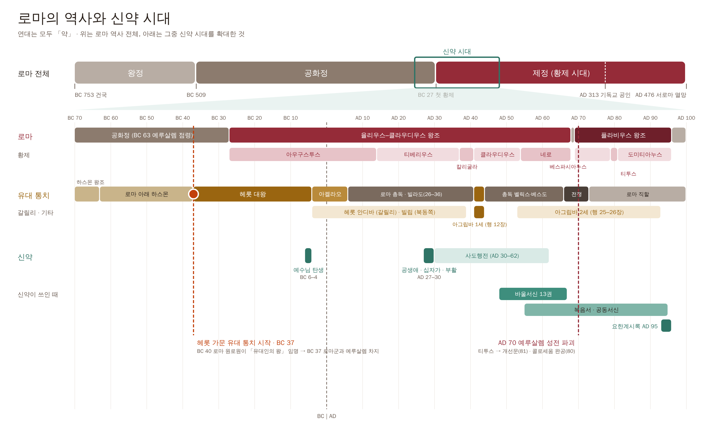

- 위: 로마 역사 전체(왕정 · 공화정 · 제정) 가운데 **신약 시대가 차지하는 자리**
- 아래: 그 자리를 확대 — 로마(왕조 · 황제) / 유대를 다스린 이 / 신약
- 세로 점선 둘: **BC 37 헤롯 가문의 유대 통치 시작**, **AD 70 예루살렘 성전 파괴**
- 원본: `scripts/bible-flow/rome-timeline.py` → `out/rome-timeline.svg` · `.png`

---

## 누가복음 3장 — 일곱 통치자로 보는 시대 (초안, 2026-11-10)

> 「디베료 가이사가 위에 있은 지 열다섯 해 곧 본디오 빌라도가 유대의 총독으로, 헤롯이 갈릴리의
> 분봉왕으로, 그 동생 빌립이 이두래와 드라고닛 지방의 분봉왕으로, 루사니아가 아빌레네의
> 분봉왕으로, 안나스와 가야바가 대제사장으로 있을 때에 **하나님의 말씀이 빈들에서 사가랴의 아들
> 요한에게 임한지라**」(눅 3:1–2)

누가는 세례 요한이 등장한 때를 **일곱 사람의 이름**으로 못 박는다. 역사가처럼 연대를 밝히면서,
동시에 그 시대의 권력 구조 전체를 한 문장에 담았다.

### 1. 일곱 통치자 — 누구이며 무엇을 했나

| 자리 | 이름 | 다스린 때 | 업적과 기록 |
|---|---|---|---|
| **로마 황제** | **디베료 가이사** (티베리우스) | AD 14–37 | 아우구스투스의 양자. 말년(AD 26–)에는 카프리 섬에 물러나 있었고, 로마에서는 **반역죄 재판**이 잦아 공포의 분위기였다. 「이 사람을 놓으면 가이사의 충신이 아니니이다」(요 19:12)에 빌라도가 흔들린 배경. 예수님이 「가이사의 것은 가이사에게」(마 22:21) 하실 때 보신 데나리온을 흔히 그의 동전으로 본다. **즉위 15년 = AD 28–29 무렵** (셈법에 따라 AD 26–27 로 보기도 한다) |
| **유대 총독** | **본디오 빌라도** | AD 26–36 | 가이사랴에 머문 로마 관리. 황제 형상이 달린 군기를 예루살렘에 들여와 소동을 일으키고, 성전 헌금으로 수로를 놓다가 항의하는 군중을 진압했다(역사가 요세푸스). 「빌라도가 어떤 갈릴리 사람들의 피를 저희의 제물에 섞은 일」(눅 13:1). 결국 사마리아인 학살로 로마에 소환된다. **1961년 가이사랴에서 「빌라도 비문」 발견** — 그가 티베리우스를 기려 세운 건물(티베리에움)을 봉헌한 돌이다 |
| **갈릴리 분봉왕** | **헤롯** (안디바) | BC 4 – AD 39 | 헤롯 대왕의 아들. 갈릴리 호숫가에 새 도시 **디베랴**를 지어 황제 티베리우스의 이름을 붙였다(요 6:23). 나사렛 가까운 세포리스도 다시 지었다. 동생의 아내 헤로디아와 결혼해 요한의 책망을 받고 그를 죽였다(막 6:17, 눅 3:19–20). 예수님은 그를 「저 여우」라 부르셨다(눅 13:32). AD 39 황제 칼리굴라가 폐위 |
| **북동부 분봉왕** | **빌립** | BC 4 – AD 34 | 헤롯 대왕의 아들. 헤르몬 산 아래에 **가이사랴 빌립보**를 지었다 — 베드로가 「주는 그리스도시요」라고 고백한 곳(마 16:13). 형제들보다 온건하게 다스렸다는 평을 받는다. 백성 다수가 이방인이라 동전에 황제 얼굴을 새겼다 |
| **아빌레네 분봉왕** | **루사니아** | 티베리우스 때 | 다메섹 북서쪽 작은 지방의 통치자. 한때 「누가가 연대를 틀렸다」는 근거로 쓰였으나, **아빌라에서 「분봉왕 루사니아」를 적은 티베리우스 시대 비문이 발견되어** 누가의 기록이 맞음이 확인되었다 |
| **대제사장** | **안나스** | AD 6–15 재임 | 로마 총독이 세웠다가 폐했다. 물러난 뒤에도 아들 다섯과 사위가 대제사장을 지낼 만큼 **실권자**였다. 예수님을 먼저 그에게 끌고 갔다(요 18:13) |
| **대제사장** | **가야바** | AD 18–36 | 안나스의 사위, 「그 해의 대제사장」(요 18:13). 빌라도와 같은 해에 물러날 만큼 로마와 손발을 맞췄다. **1990년 예루살렘에서 「가야바」 이름이 새겨진 유골함 발견** |

### 2. 그래서 당시의 상황은

**정치 — 세 겹의 지배, 쪼개진 땅**

- 맨 위에 **로마 황제**, 그 아래 **로마 총독**(유대)과 **헤롯 가문 분봉왕들**(갈릴리 · 북동부),
  그리고 **대제사장**. 대제사장마저 **로마 총독이 세우고 폐했다** — 종교 지도자도 로마의 손 안이었다.
- 한 민족의 땅이 넷으로 쪼개져 있었다(유대 · 갈릴리 · 이두래와 드라고닛 · 아빌레네).
  누가가 이름을 일곱이나 대야 했던 것 자체가 **나라 잃은 백성의 형편**을 보여 준다.

**경제 — 겹겹의 세금**

- 로마에 내는 세금, 분봉왕이 거두는 세금, 성전세와 십일조가 겹쳤다. 거두는 일은 **세리**가 맡았고,
  정해진 것보다 더 거둬 제 몫을 챙겼다.
- 같은 장에서 요한이 세리에게 「정한 세 외에는 늑징치 말라」(눅 3:13), 군병에게 「사람에게
  강포하지 말며 무소하지 말고 받는 요를 족한 줄로 알라」(눅 3:14) 한 것이 바로 이 현실이다.

**종교 — 성전은 있으나**

- 성전과 제사는 이어졌지만 대제사장직은 **정치 자리**가 되었다. 사두개파 제사장 가문이 로마와
  손잡고 권력과 부를 지켰다.
- 백성은 메시아를 기다렸다 — 「백성들이 바라고 기다리므로 모든 사람들이 요한을 혹 그리스도신가
  심중에 의논하니」(눅 3:15).

**사회 · 문화 — 헬라 도시와 유대 마을**

- 디베랴 · 세포리스 · 가이사랴 빌립보 · 가이사랴 같은 **헬라 · 로마식 도시**가 황제의 이름을 달고
  세워졌다. 극장 · 경기장 · 신전이 들어섰다.
- 그 곁에 회당을 중심으로 율법을 지키는 **유대인 마을**(나사렛 · 가버나움)이 있었다. 황제의 형상과
  이방 신전은 경건한 유대인에게 깊은 반감을 샀다(빌라도의 군기 사건).

### 3. 맥잡기 — 누가가 말하려는 것

일곱 권력자의 이름이 줄지어 나온 뒤, 문장은 이렇게 끝난다 —
**「하나님의 말씀이 빈들에서 사가랴의 아들 요한에게 임한지라」**(눅 3:2).

- 말씀은 **로마의 궁전**에도, **헤롯의 왕궁**에도, **대제사장의 성전**에도 아니라 **빈들(광야)**의
  요한에게 임했다.
- 복음은 **실제 역사의 한복판**에서 시작되었다 — 누가는 그 증거로 연대를 확인할 수 있는 이름들을 댔고,
  빌라도 비문 · 루사니아 비문 · 가야바 유골함이 그 이름들이 실제 인물이었음을 보여 준다.

📷 보여줄 것: 빌라도 비문(이스라엘 박물관), 가야바 유골함, 티베리우스 데나리온, 디베랴 · 가이사랴 빌립보 유적

---

## 복음서의 내용

**복음서는 4복음서가 있다.**

### 공관복음 — 마태 · 마가 · 누가

- 세 권을 **공관복음**이라 부른다. **같은 관점으로 보았다**는 뜻이다.

> 덧붙임: 공관(共觀)은 「함께 본다」는 말이다. 세 권은 내용과 순서가 많이 겹쳐 **나란히 놓고
> 함께 볼 수 있다** — 그래서 「같은 관점」이다.

### 요한복음 — 다른 관점, 절기 중심

- 요한복음에는 **세 복음서에 나오지 않는 내용이 많다.** 다른 관점으로 보았다.
- 공관복음은 시간 순서대로 기록했지만, 요한복음은 특별히 **절기에 일어난 사건**을 중심으로 다뤘다.
- **절기 중심으로 쓰였다는 것이 요한복음의 중요한 특징이다.**

| 절기 | 요한복음 | 장면 |
|---|---|---|
| 유월절 ① | 2:13 | 성전 정결, 니고데모(3장) |
| 유대인의 명절 | 5:1 | 베데스다 못 38년 된 병자 |
| 유월절 ② | 6:4 | 오병이어, 「나는 생명의 떡이니」 |
| 초막절 | 7:2 | 「누구든지 목마르거든 내게로 와서 마시라」(7:37) |
| 수전절 | 10:22 | 「나와 아버지는 하나이니라」(10:30) |
| 유월절 ③ | 11:55 | 마지막 한 주간 — 12장부터 끝까지 |

> **검토 (2026-11-10)**
> - **「절기에 일어난 사건만」은 조금 넘친다.** 절기를 **뼈대**로 삼은 것은 맞지만, 절기가 아닌 때의
>   일도 있다 — 가나 혼인 잔치(2:1–11, 첫 표적), 사마리아 여인(4장), 왕의 신하의 아들(4:46–54).
>   「**절기를 따라 짜였다**」, 「**절기를 뼈대로 삼았다**」가 정확하다.
> - **「공관복음은 시간 순서대로」도 조금 조심.** 큰 흐름은 시간 순서지만, 마태복음은 가르침을 주제별
>   다섯 묶음으로 모았고(5–7, 10, 13, 18, 24–25장) 사건 순서가 세 권끼리 다른 곳도 있다.
>   「**공관복음은 갈릴리에서 예루살렘으로 가는 한 번의 길**로, **요한복음은 절기마다 예루살렘을 오르내린
>   길**로 그렸다」라고 하면 차이가 선명하다.
> - 유월절이 세 번 나와서(2:13, 6:4, 11:55) **공생애를 약 3년**으로 본다 — 이것도 요한복음 덕분이다.

## 복음서 맥점 — 스토리 청크

복음서에는 **여기저기 반복해서 쓰인 이야기**도 있고, **한 복음서에만 나오는 이야기**도 있다.
복음서를 명확하고 간단하게 이해하는 좋은 방법이 있다 — 또 하나의 맥점, **복음서 맥점**.

**스토리 청크(story chunk)로 내용을 파악하는 것이다.**

- **스토리 청크 = 이야기 덩어리.** 복음서에는 **공통적으로 나오는 이야기 덩어리**가 있다.

**총 7가지로 나눌 수 있다.**

| # | 스토리 청크 | 마태 | 마가 | 누가 | 요한 |
|---|---|---|---|---|---|
| 1 | **예수님의 탄생** — 마태 · 누가에만 나온다 | 1–2장 | — | 1–2장 | — (1:1–18 말씀이 육신이 되심) |
| 2 | **세례 요한** | 3장 | 1:1–13 | 3:1–4:13 | 1:19–34 |
| 3 | **갈릴리 사역** | 4:12–14장 | 1:14–6장 | 4:14–9:9 | 2장, 4장 (일부) |
| 4 | **오병이어** | 14:13–21 | 6:30–44 | 9:10–17 | 6:1–14 |
| 5 | **수난 예고** | 16:21 · 17:22–23 · 20:17–19 | 8:31 · 9:31 · 10:33–34 | 9:22 · 9:44 · 18:31–33 | (다른 방식 — 「인자도 들려야 하리니」 3:14, 12:32) |
| 6 | **예루살렘 사역** (최후의 만찬까지) | 21–26:30 | 11–14:26 | 19:28–22:38 | 12–17장 (요한은 절기마다 예루살렘 사역이 앞에도 있다) |
| 7 | **십자가와 부활** (최후의 만찬 이후 — 겟세마네부터) | 26:36–28장 | 14:32–16장 | 22:39–24장 | 18–21장 |

> 덧붙임 (장절은 「대략」 — 청크의 경계를 잡는 용도)
> - **오병이어는 부활을 빼면 네 복음서에 모두 나오는 유일한 기적이다.** 그래서 공관복음과 요한복음을
>   잇는 **이음매**로 쓰기 좋다.
> - 공관복음에서는 **오병이어(4) → 베드로의 고백 → 첫 수난 예고(5)** 가 바로 이어진다(누가복음은
>   9:10–17 → 9:18–22 로 붙어 있다). 청크 3·4 가 「누구신가」, 청크 5 부터 「무엇을 하러 오셨나」로
>   이야기가 돌아선다.
> - 수난 예고는 공관복음마다 **세 번**씩이다.

### 청크 1 — 예수님의 탄생

- **마태복음과 누가복음에서만 나온다.**

### 청크 2 — 세례 요한

- 세례 요한 스토리는 **4복음서가 다 다루고 있다.**
- 세례 요한의 스토리는 **예수님이 세례받으시고 → 성령이 임하시고 → 광야에서 마귀에게 시험받으시는**
  스토리와 **한 덩어리**로 묶여 있다.

| 장면 | 마태 | 마가 | 누가 | 요한 |
|---|---|---|---|---|
| 세례 요한의 사역 | 3:1–12 | 1:1–8 | 3:1–20 | 1:19–28 |
| 예수님의 세례 · 성령 강림 | 3:13–17 | 1:9–11 | 3:21–22 | (직접 쓰지 않음 — 요한의 증언으로만, 1:32–34) |
| 광야의 시험 | 4:1–11 | 1:12–13 | 4:1–13 | — |

> **검토 (2026-11-10)**
> - **「4복음서가 다 다룬다」는 세례 요한에 대해서는 맞다.** 다만 같은 덩어리 안의 **광야 시험은 요한복음에
>   없고**, 예수님이 세례받으시는 장면도 요한복음은 직접 그리지 않고 세례 요한의 증언으로만 전한다
>   — 「내가 보매 성령이 비둘기같이 하늘로서 내려와서 그의 위에 머물렀더라」(요 1:32).
>   그래서 「**세례 요한은 넷 다, 세례와 시험까지의 한 덩어리는 공관복음 셋**」이라고 하면 정확하다.
> - **「성령으로 세례받으시고」는 표현을 다듬자.** 성경은 예수님이 물로 세례받으실 때 **성령이 비둘기같이
>   임하셨다**고 한다(막 1:10). 「성령으로 세례를 주시는」 분은 예수님 쪽이다 — 「그는 성령으로 너희에게
>   세례를 주시리라」(막 1:8). → 「**세례받으실 때 성령이 비둘기같이 임하시고, 하늘에서 '너는 내 사랑하는
>   아들이라' 하는 소리가 났다**」(막 1:10–11).
> - 덩어리를 잇는 고리: 「**성령이 곧 예수를 광야로 몰아 내신지라**」(막 1:12) — 세례 바로 다음이 시험이다.

### 청크 3 — 갈릴리 사역

1. **선포** — 「회개하라 천국이 가까이 왔다」
2. **제자들을 부르신다**
3. **사역** — 복음을 전하시고, 전파하시고, 가르치시고, 치유하신다
4. **논쟁** — 그 가운데 **안식일 논쟁**, **바알세불 논쟁**을 하신다

| 장면 | 마태 | 마가 | 누가 |
|---|---|---|---|
| 선포 | 4:17 | 1:14–15 | 4:14–15 |
| 제자를 부르심 | 4:18–22 | 1:16–20 | 5:1–11 |
| 가르치고 · 전파하고 · 고치심 | 4:23 (9:35) | 1:21–39 | 4:31–44 |
| 안식일 논쟁 | 12:1–14 | 2:23–3:6 | 6:1–11 |
| 바알세불 논쟁 | 12:22–32 | 3:22–30 | 11:14–23 |

> 덧붙임 (근거 구절)
> - 선포: 「이 때부터 예수께서 비로소 전파하여 가라사대 회개하라 천국이 가까왔느니라 하시더라」(마 4:17) ·
>   「때가 찼고 하나님 나라가 가까왔으니 회개하고 복음을 믿으라」(막 1:15).
> - 사역의 세 가지가 한 절에 다 있다 — 「예수께서 온 갈릴리에 두루 다니사 저희 회당에서 **가르치시며**
>   천국 복음을 **전파하시며** 백성 중에 모든 병과 모든 약한 것을 **고치시니**」(마 4:23). 9:35 에 거의 같은
>   문장이 한 번 더 나와 **갈릴리 사역의 앞뒤를 묶는 괄호**가 된다.
> - 바알세불 논쟁은 「예루살렘에서 내려온 서기관들」이 일으킨다(막 3:22) — 갈릴리에서 이미 예루살렘과의
>   충돌이 시작된다.
>
> **검토 (2026-11-10)** — 틀린 곳은 없다. 두 가지만:
> - 누가복음은 바알세불 논쟁을 갈릴리가 아니라 **예루살렘으로 가는 길**(9:51 이후, 11장)에 둔다.
>   「공관복음 모두에 나오지만 누가는 자리가 다르다」.
> - 요한복음에도 안식일 논쟁이 있지만 **예루살렘**에서다(5장 베데스다, 9장 날 때부터 소경 된 사람).

### 청크 4 — 오병이어

**왜 따로 두는가** — 이 시점에 예수님의 사역이 커지면서 **유대 종교 지도자들이 예수님을 죽이려는
의도**가 드러났기 때문이다.

- 이때도 **유월절**이었다. 예수님은 예루살렘에 가셔야 했지만, 예루살렘에 예수님을 죽이려는 자들이
  있었기 때문에 **올라가지 않으시고 갈릴리에서** 오병이어 기적을 일으키셨다.
- 오병이어 사건 전에 **세례 요한이 순교**한다. 그로 인해 예수님을 죽이려는 의도들이 **수면 위로**
  드러나면서, 예수님은 예루살렘에 가지 않으시고 **갈릴리에서 절기를 보내셨다.**

**덩어리** — 세례 요한의 순교 → **오병이어** → **물 위를 걸어 제자들에게 오심** → 갈릴리 주변 마을을
다니시며 치유하시고 복음을 전하심 → 다시 **칠병이어**

| 장면 | 마태 | 마가 | 누가 | 요한 |
|---|---|---|---|---|
| 세례 요한의 순교 | 14:1–12 | 6:14–29 | (9:7–9 헤롯의 말로만) | — |
| 오병이어 | 14:13–21 | 6:30–44 | 9:10–17 | 6:1–14 (6:4 유월절) |
| 물 위를 걸으심 | 14:22–33 | 6:45–52 | — | 6:16–21 |
| 주변 마을 · 치유 · 전도 | 14:34–15:31 | 6:53–7:37 | — | 6:22–71 (생명의 떡 설교) |
| 칠병이어 | 15:32–39 | 8:1–10 | — | — |

> 덧붙임 (근거 구절)
> - 순교 소식 → 물러나심이 바로 붙어 있다: 「예수께서 **들으시고** 배를 타고 떠나사 따로 빈 들에 가시니」(마 14:13).
> - 유월절: 「마침 유대인의 명절인 유월절이 가까운지라」(요 6:4).
> - 예루살렘에 가지 않으신 이유를 요한이 직접 말한다: 「이후에 예수께서 갈릴리에서 다니시고 유대에서
>   다니려 아니하심은 **유대인들이 죽이려 함이러라**」(요 7:1).
> - 오병이어 뒤 무리는 예수님을 「억지로 잡아 임금 삼으려」 했다(요 6:15) — 인기가 꼭대기에 오른 순간이자,
>   생명의 떡 설교 뒤 많은 제자가 떠나는(요 6:66) **갈림길**이다.
>
> **검토 (2026-11-10)**
> - **「이 시점에 죽이려는 의도를 갖기 시작했다」는 「드러났다 · 커졌다」로.** 죽이려는 의논은 그 전부터 있었다 —
>   안식일 논쟁 뒤 「바리새인들이 나가서 곧 헤롯당과 함께 어떻게 하여 예수를 죽일꼬 의논하니라」(막 3:6),
>   요한복음도 5장에서 「더욱 예수를 죽이고자 하니」(요 5:18). 선생님 말씀대로 **수면 위로 드러난** 때로 말하면 정확하다.
> - **「유월절에 예루살렘에 가지 않으셨다」는 요 6:4 와 7:1 을 이어 읽은 해석이다.** 본문이 「그래서 이번 유월절에는
>   가지 않으셨다」고 직접 말하지는 않는다. 「요한복음은 유월절이 가까울 때 예수님이 갈릴리에 계셨다고 하고,
>   곧이어 유대인들이 죽이려 해서 유대에 다니지 않으셨다고 말한다」로 하면 본문 그대로다.
> - **세례 요한의 순교와 「예수님을 죽이려는 의도」의 연결**: 본문에서 순교 직후 바로 이어지는 것은 헤롯이
>   예수님을 「세례 요한이 살아난 것」으로 여긴 일(마 14:1–2)과 예수님이 **물러나신** 일(14:13)이다.
>   「요한을 죽인 권력이 이제 예수님을 주목한다」로 말하면 본문과 맞는다.
> - 말: 예루살렘은 「**올라가다**」(요 2:13, 5:1), 갈릴리 쪽은 「내려가다」.
> - 칠병이어는 마태 · 마가에만 있고, 주변 마을 가운데 두로 · 시돈(수로보니게 여인, 마 15:21)과 데가볼리(막 7:31)는
>   **이방 지역**이다 — 오병이어는 유대인 무리, 칠병이어는 이방 지역 무리로 보는 해석이 많다.

### 청크 5 — 수난 예고

예수님께서 사역하시면서 **십자가에서 죽고 부활하실 것을 제자들에게 예고**하셨다는 내용이 **3번** 나온다.

| 차례 | 어디서 | 마태 | 마가 | 누가 | 무엇이 더해지나 |
|---|---|---|---|---|---|
| **1번** | **가이사랴 빌립보** — 베드로의 고백 직후 | 16:21 | 8:31 | 9:22 | 처음으로 「죽임을 당하고 제 삼일에 살아나야 할 것」 |
| **2번** | **갈릴리** — 변화산과 귀신 들린 아이를 고치신 뒤 | 17:22–23 | 9:30–32 | 9:43–45 | 「사람들의 손에 **넘기워**」 — 넘겨진다(배신) |
| **3번** | **예루살렘으로 올라가는 길** — 여리고 가까이 | 20:17–19 | 10:32–34 | 18:31–34 | 가장 자세하다 — 「**이방인들에게** 넘겨 주어 능욕하며 채찍질하며 **십자가에 못박게**」 |

- 선생님 정리: 수난 예고는 **가이사랴 빌립보**에서, 그리고 **변화산 사건 이후**에, 그리고 마지막으로 **예루살렘에
  올라가시며** 말씀하셨다. 예루살렘에 들어가시고 **그 주간에** 십자가를 지시기 때문이다.

> **검토 (2026-11-10)** — 세 번째 예고는 예루살렘에 **도착하신 뒤가 아니라 올라가시는 길에서**다 — 「예수께서 예루살렘으로
> 올라 가려 하실 때에 열 두 제자를 따로 데리시고 **길에서** 이르시되」(마 20:17). 그 뒤 여리고를 지나(20:29) 입성하신다(21:1).
> 그리고 입성(일요일)에서 십자가(금요일)까지는 **닷새** 남짓이라 「일주일 뒤」보다 「**그 주간에**」가 정확하다.

- **1번**: 가이사랴 빌립보에서 제자들을 가르치실 때 예고하셨다. 이 말씀을 하시고 **그 다음해 유월절**에
  예수님은 십자가에 달리신다.

> 덧붙임 (근거 구절 — 마태복음)
> 1. 「이 때로부터 예수 그리스도께서 자기가 예루살렘에 올라가 장로들과 대제사장들과 서기관들에게 많은 고난을
>    받고 죽임을 당하고 제 삼일에 살아나야 할 것을 제자들에게 **비로소** 가르치시니」(마 16:21)
> 2. 「**갈릴리에 모일 때에** 예수께서 제자들에게 이르시되 인자가 장차 사람들의 손에 넘기워 죽임을 당하고
>    제 삼일에 살아나리라 하시니 제자들이 심히 근심하더라」(마 17:22–23)
> 3. 「보라, 우리가 **예루살렘으로 올라 가노니** 인자가 대제사장들과 서기관들에게 넘기우매 저희가 죽이기로
>    결안하고 이방인들에게 넘겨 주어 그를 능욕하며 채찍질하며 십자가에 못박게 하리니 제 삼일에 살아나리라」(마 20:18–19)
>
> - **장소가 점점 예루살렘으로 다가간다** — 북쪽 끝 가이사랴 빌립보 → 갈릴리 → 예루살렘 가는 길. 예고가 거듭될수록
>   **내용도 구체적**이 된다(죽음 → 넘겨짐 → 이방인 · 채찍 · 십자가).
> - 세 번 모두 **「제 삼일에 살아나리라」로 끝난다** — 수난 예고는 언제나 부활 예고이기도 하다.
> - 세 번 모두 제자들은 알아듣지 못한다 — 베드로가 항변하고(마 16:22), 심히 근심하고(17:23), 누가는 「그 말씀이
>   감취었으므로 저희가 그 이르신 바를 알지 못하였더라」(눅 18:34). 그리고 바로 뒤에 **누가 크냐 다툼**이 이어진다
>   (막 9:33–34, 10:35–45).
> - 「그 다음해 유월절」: 오병이어가 유월절 무렵(요 6:4)이고 가이사랴 빌립보는 그 직후라, 십자가까지 약 1년으로 본다.

### 청크 6 — 예루살렘 사역

그 뒤로 **예루살렘 스토리**가 이어진다. 예수님은 절기마다 예루살렘에 올라오셨지만, 여기서 **예루살렘 청크**는
**십자가를 지시기 전에 예루살렘에서 있었던 이야기들**이다.

- **예루살렘성에 입성**하신다.
- 여기서도 주님은 **논쟁**하신다.
- **재림과 심판**에 대한 말씀과 **비유**들을 하신다.
- **최후의 만찬** — 유월절 식탁을 제자들과 가지신다.

| 장면 (본문 순서) | 마태 | 마가 | 누가 | 요한 |
|---|---|---|---|---|
| 예루살렘 입성 · 성전 정결 | 21:1–17 | 11:1–19 | 19:28–48 | 12:12–19 (성전 정결은 2장에) |
| 논쟁 — 권위 · 세금 · 부활 · 큰 계명 · 다윗의 자손 | 21:23–22:46 | 11:27–12:37 | 20장 | — |
| 바리새인 책망 · 과부의 두 렙돈 | 23장 | 12:38–44 | 20:45–21:4 | — |
| 재림과 심판의 말씀 (감람산 강화) | 24장 | 13장 | 21:5–36 | — |
| 비유 — 열 처녀 · 달란트 · 양과 염소 | 25장 | — | — | — |
| 최후의 만찬 (유월절 식탁) | 26:17–30 | 14:12–26 | 22:7–38 | 13–17장 (세족 · 다락방 강화 · 대제사장의 기도) |

> **검토 (2026-11-10)**
> - **순서**: 본문에서는 **입성이 먼저**다 — 입성 → 성전 정결 → 논쟁 → 재림·심판 말씀과 비유 → 최후의 만찬.
>   수업에서 「입성으로 시작해 만찬으로 끝나는 한 주간」으로 말하면 청크가 선명해진다.
> - 말: 예루살렘은 「**올라오셨다**」(내려오셨다 X).
> - **청크 경계**: 최후의 만찬을 청크 6 에 넣으셨으므로, 청크 7 은 **겟세마네부터** 시작한다(위 7청크 표도 그렇게 고쳤다).
> - 요한복음의 만찬에는 떡과 잔을 나누는 장면 대신 **발을 씻기심**(13장)과 긴 고별 설교(14–17장)가 있다.
> - 덧붙임: 입성부터 부활까지가 **한 주간**이다 — 복음서 분량의 큰 몫이 이 한 주간에 쓰였다(마태 21–28장, 마가 11–16장,
>   요한 12–21장).

### 청크 7 — 십자가와 부활 (최후의 만찬 이후)

**겟세마네 기도 → 잡히심 → 심문당하심 → 고난당하심 → 십자가를 지심 → 죽으심 → 부활하심**

| 장면 | 마태 | 마가 | 누가 | 요한 |
|---|---|---|---|---|
| 겟세마네 기도 | 26:36–46 | 14:32–42 | 22:39–46 | (18:1 「동산」 — 기도 장면은 없음) |
| 잡히심 | 26:47–56 | 14:43–52 | 22:47–53 | 18:2–12 |
| 심문 ① 대제사장 · 공회 (베드로의 부인) | 26:57–75 | 14:53–72 | 22:54–71 | 18:13–27 |
| 심문 ② 빌라도 (누가는 헤롯도) | 27:1–26 | 15:1–15 | 23:1–25 | 18:28–19:16 |
| 고난 — 채찍질 · 조롱 · 가시관 | 27:26–31 | 15:15–20 | 23:11 | 19:1–3 |
| 십자가를 지심 — 골고다 | 27:32–44 | 15:21–32 | 23:26–43 | 19:17–27 |
| 죽으심 | 27:45–56 | 15:33–41 | 23:44–49 | 19:28–37 |
| (장사 지냄) | 27:57–66 | 15:42–47 | 23:50–56 | 19:38–42 |
| 부활하심 | 28장 | 16장 | 24장 | 20–21장 |

> **검토 (2026-11-10)**
> - 표기: 「**겟세마네**」(마 26:36).
> - **「장사 지냄」을 넣으면 좋겠다.** 바울이 정리한 복음의 핵심이 「죽으시고 → **장사 지낸 바 되었다가** → 사흘 만에
>   다시 살아나사」다 — 「성경대로 그리스도께서 우리 죄를 위하여 죽으시고 장사 지낸 바 되었다가 성경대로 사흘 만에
>   다시 살아나사」(고전 15:3–4). 무덤에 묻히셨다는 것이 **정말 죽으셨다**는 증거이고, **빈 무덤**의 전제다.
> - 요한복음은 겟세마네라는 이름을 쓰지 않고 「기드론 시내 저편 … 동산」(요 18:1)이라고만 하며, 땀이 피 방울같이
>   되도록 기도하신 장면도 없다.

---

## 스토리 청크별 4복음서 범위 — 한 장 정리

> 네 복음서를 **처음부터 끝까지 빈틈없이** 일곱 청크로 나눈 것이다(장:절은 청크의 경계).
> 「—」는 그 복음서에 그 청크가 없다는 뜻.

| # | 스토리 청크 | 마태복음 | 마가복음 | 누가복음 | 요한복음 |
|---|---|---|---|---|---|
| 1 | **예수님의 탄생** | 1–2장 | — | 1–2장 | — (1:1–18 말씀이 육신이 되심) |
| 2 | **세례 요한** (세례 · 시험) | 3:1–4:11 | 1:1–13 | 3:1–4:13 | 1:19–51 |
| 3 | **갈릴리 사역** | 4:12–13:58 | 1:14–6:13 | 4:14–9:9 | 2–5장 (갈릴리 · 예루살렘 · 사마리아를 오감) |
| 4 | **오병이어** (요한 순교 – 칠병이어) | 14:1–16:12 | 6:14–8:26 | 9:10–17 | 6장 |
| 5 | **수난 예고** (가이사랴 빌립보 – 여리고) | 16:13–20:34 | 8:27–10:52 | 9:18–19:27 | 7–11장 (초막절 · 수전절 · 나사로) |
| 6 | **예루살렘 사역** (입성 – 최후의 만찬) | 21:1–26:35 | 11:1–14:31 | 19:28–22:38 | 12–17장 |
| 7 | **십자가와 부활** (겟세마네 – 부활) | 26:36–28:20 | 14:32–16:20 | 22:39–24:53 | 18–21장 |

**표에서 보이는 것**

- **마태 · 마가 · 누가는 일곱 청크가 같은 순서**로 흐른다 — 이것이 「공관(함께 보는)」복음이다.
- **마가복음은 1번이 없다** — 곧바로 세례 요한으로 시작한다. 가장 짧고 빠르다.
- **누가복음의 5번이 유난히 길다**(9:18–19:27) — 9:51 부터 「예루살렘으로 올라가는 길」을 열 장 가까이 적었고,
  선한 사마리아인 · 탕자 같은 **누가에만 있는 비유**가 여기 모여 있다. 대신 4번은 오병이어 하나뿐이다.
- **요한복음은 3–5번이 절기를 따라 짜여 있어** 공관복음과 경계가 딱 맞지는 않는다. 오병이어(6장)와
  예루살렘 입성(12장)이 두 흐름을 맞춰 주는 **이음매**다.
- **6–7번(마지막 한 주간)의 분량** — 마태 8장/28장, 마가 6장/16장, 누가 6장/24장, 요한 10장/21장.
  요한복음은 거의 **절반**이 마지막 한 주간이다.

---

## 요한복음 — 장별 제목과 절기

요한복음은 **독특한 구조**로 되어 있다 — **절기를 따라** 예루살렘을 오르내리며 짜였다.

**절기 순서: 유월절 → 이름 없는 명절(초막절로 보는 견해도 있음) → 유월절(오병이어) → 초막절 → 수전절 → 유월절(십자가)**

| 장 | 제목 | 절기 | 표적 · 「나는 ~이다」 |
|---|---|---|---|
| 1 | 말씀이 육신이 되어 · 세례 요한의 증언 · 첫 제자들 | | |
| 2 | 가나 혼인 잔치 · 성전 정결 | 🟥 **유월절 ①** (2:13, 2:23) | 표적 1 물이 포도주로 |
| 3 | 니고데모 — 거듭나야 하리라 | 〃 (유월절에 예루살렘) | |
| 4 | 사마리아 여인 · 왕의 신하의 아들 | | 표적 2 왕의 신하의 아들 |
| 5 | 베데스다 38년 된 병자 · 안식일 논쟁 | 🟨 **유대인의 명절** (5:1 — 이름 없음) | 표적 3 38년 된 병자 |
| 6 | 오병이어 · 물 위를 걸으심 · 생명의 떡 | 🟥 **유월절 ②** (6:4) — 갈릴리에서 | 표적 4 오병이어 · 표적 5 물 위를 걸으심 · 「**나는 생명의 떡**」(6:35) |
| 7 | 초막절에 올라가심 · 생수의 강 | 🟩 **초막절** (7:2, 7:37) | |
| 8 | 간음한 여인 · 세상의 빛 | 〃 (초막절 이어서) | 「**나는 세상의 빛**」(8:12) |
| 9 | 날 때부터 소경 된 사람 | 〃 (초막절 뒤) | 표적 6 소경이 보게 됨 |
| 10 | 선한 목자 · 「나와 아버지는 하나」 | 🟦 **수전절** (10:22) | 「**나는 양의 문**」(10:7) · 「**나는 선한 목자**」(10:11) |
| 11 | 나사로를 살리심 · 죽이려는 공회 | 🟥 **유월절 ③** 가까움 (11:55) | 표적 7 나사로 · 「**나는 부활이요 생명**」(11:25) |
| 12 | 베다니의 향유 · 예루살렘 입성 | 〃 유월절 엿새 전 (12:1) | |
| 13 | 발을 씻기심 · 새 계명 | 〃 유월절 전 (13:1) — 최후의 만찬 | |
| 14 | 길 · 진리 · 생명 · 보혜사 약속 | 〃 (다락방 강화) | 「**나는 길이요 진리요 생명**」(14:6) |
| 15 | 포도나무와 가지 | 〃 | 「**나는 포도나무**」(15:5) |
| 16 | 성령이 오시면 · 근심이 기쁨으로 | 〃 | |
| 17 | 대제사장의 기도 | 〃 | |
| 18 | 잡히심 · 안나스 · 베드로의 부인 · 빌라도 | 〃 | |
| 19 | 십자가 · 「다 이루었다」 · 장사 | 〃 **유월절의 예비일** (19:14) | |
| 20 | 빈 무덤 · 막달라 마리아 · 도마 | | |
| 21 | 디베랴 바닷가 · 「내 양을 먹이라」 | | |

**스토리 청크와 맞추면**: 2청크 1장 · 3청크 2–5장 · 4청크 6장 · 5청크 7–11장 · 6청크 12–17장 · 7청크 18–21장.

**한눈에 — 요한복음은 일곱 표적과 일곱 「나는 ~이다」가 절기 위에 놓인 책**이다. 그리고 책의 절반(12–21장)이
마지막 유월절 한 주간이다.

> **검토 (2026-11-10)** — 선생님 말씀의 순서 「유월절, **초막절**, 유월절(오병이어), 초막절, 수전절, 유월절」에서
> **두 번째(5:1)는 본문이 이름을 밝히지 않는다** — 「그 후에 **유대인의 명절**이 있어 예수께서 예루살렘에
> 올라가시니라」(5:1). 이것을 초막절로 보는 견해도 있지만 유월절 · 오순절 · 부림절로 보는 견해도 있다.
> 그래서 「**유월절 → 이름 없는 명절(초막절로 보는 견해) → 유월절 → 초막절 → 수전절 → 유월절**」로 말하면 정확하다.
> 이름이 분명한 것만 세면 **유월절 셋 · 초막절 하나 · 수전절 하나**다 — 공생애 약 3년의 근거.
>
> 표적의 수는 보는 사람에 따라 조금 다르다(물 위를 걸으심을 빼고 21장의 고기 잡은 기적을 넣기도 한다). 「일곱」은
> 가장 흔한 셈이다. 「나는 ~이다」 일곱은 모두 본문 그대로다.

### 청크로 나눠 보면 복음서마다의 특징이 드러난다 (선생님 말씀)

- **누가복음은 5번(수난 예고) 청크가 유난히 길다 — 그게 누가복음의 특징이다.** 이렇게 구분해야 누가복음에
  **어느 시점의 스토리가 많이 더해졌는지**를 알 수 있다.
- **요한복음도 마찬가지로, 마지막 한 주간의 스토리가 내용의 절반**이라는 것을 드러내 준다.

### 도식 — 스토리 청크로 본 네 복음서

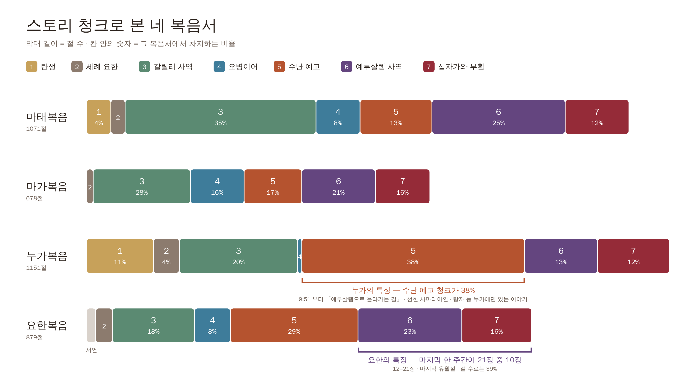

- 막대 길이 = 절 수(앱 성경 DB 에서 직접 셈). 칸 안 = 그 복음서에서 차지하는 비율.
- **누가복음 5번 청크 38%** — 누가의 특징. **요한복음 6–7번 = 21장 중 10장**(절 수로는 39%) — 요한의 특징.
- 원본: `scripts/bible-flow/gospel-chunks.py` → `out/gospel-chunks.svg` · `.png`

---

## 사도행전 — 1장은 복음서의 마지막과 이어진다

**사도행전 1장은 복음서의 마지막과 연결된다. 직접적으로는 누가복음과 연결된다** — 같은 저자(누가)가 같은 사람
(데오빌로)에게 쓴 **두 권짜리 한 책**이다.

### 누가복음 24장 ↔ 사도행전 1장

| | 누가복음 (끝) | 사도행전 (시작) |
|---|---|---|
| 받는 사람 | 「데오빌로 각하에게 차례대로 써 보내는 것이 좋은 줄 알았노니」(눅 1:3) | 「**데오빌로여 내가 먼저 쓴 글에는** 무릇 예수의 행하시며 가르치시기를 시작하심부터」(행 1:1) |
| 부활 후 나타나심 | 엠마오 길, 제자들에게 나타나심(24:13–43) | 「**사십 일 동안** 저희에게 보이시며 하나님 나라의 일을 말씀하시니라」(1:3) |
| 아버지의 약속 | 「내가 내 아버지의 약속하신 것을 너희에게 보내리니 너희는 위로부터 능력을 입히울 때까지 **이 성에 유하라**」(24:49) | 「**예루살렘을 떠나지 말고** 내게 들은 바 아버지의 약속하신 것을 기다리라」(1:4) |
| 사명 | 「죄 사함을 얻게 하는 회개가 **예루살렘으로부터 시작하여 모든 족속에게** 전파될 것」(24:47) | 「예루살렘과 온 유대와 사마리아 **땅 끝까지** 이르러 내 증인이 되리라」(1:8) |
| 승천 | 「베다니 앞까지 나가사 … 저희를 떠나 (하늘로 올리우)시니」(24:50–51) | 「저희 보는데서 **올리워 가시니** 구름이 저를 가리워」(1:9) |
| 예루살렘으로 돌아감 | 「큰 기쁨으로 예루살렘에 돌아가」(24:52) | 「감람원이라 하는 산으로부터 예루살렘에 돌아오니」(1:12) |

**누가복음은 승천으로 끝나고, 사도행전은 승천으로 시작한다.** 한 장면이 두 책을 잇는 경첩이다.
(마태복음의 끝 「가서 모든 족속으로 제자를 삼아」(마 28:19)도 행 1:8 과 같은 사명이다.)

### 세례 요한의 예언 → 사도행전 2장의 성취

세례 요한은 예수님을 「**성령과 불로 세례를 주실 분**」으로 소개했다. 그 예언이 **행 2장 오순절**에 이루어진다.

| 단계 | 말씀 | 본문 |
|---|---|---|
| **예언** — 세례 요한 (청크 2) | 「나는 물로 너희에게 세례를 주거니와 나보다 능력이 많으신 이가 오시나니 … 그는 **성령과 불로** 너희에게 세례를 주실 것이요」 | 눅 3:16 (마 3:11 · 막 1:8 · 요 1:33) |
| **약속** — 승천 직전의 예수님 | 「요한은 물로 세례를 베풀었으나 너희는 **몇 날이 못 되어 성령으로 세례를 받으리라**」 | 행 1:5 |
| **성취** — 오순절 | 「홀연히 하늘로부터 급하고 강한 **바람** 같은 소리가 있어 … **불의 혀같이** 갈라지는 것이 저희에게 보여 각 사람 위에 임하여 있더니 저희가 다 **성령의 충만함**을 받고」 | 행 2:2–4 |
| **설명** — 베드로의 설교 | 「하나님이 오른손으로 예수를 높이시매 그가 약속하신 성령을 아버지께 받아서 너희 보고 듣는 이것을 **부어 주셨느니라**」 | 행 2:33 |
| **확인** — 고넬료의 집 | 「내가 주의 말씀에 **요한은 물로 세례를 주었으나 너희는 성령으로 세례 받으리라** 하신 것이 생각났노라」 | 행 11:16 |

- 요한이 말한 「**불**」이 오순절의 「**불의 혀**」로, 「**성령**」이 「**성령의 충만함**」으로 그대로 나타난다.
- **세례를 주시는 분은 예수님이다** — 베드로는 성령을 「예수께서 아버지께 받아 부어 주셨다」고 설명한다(2:33).
  청크 2 에서 요한이 소개한 바로 그분이 오순절에 일하신 것이다.

### 행 1:8 대로 퍼져 나간 복음 — 도식

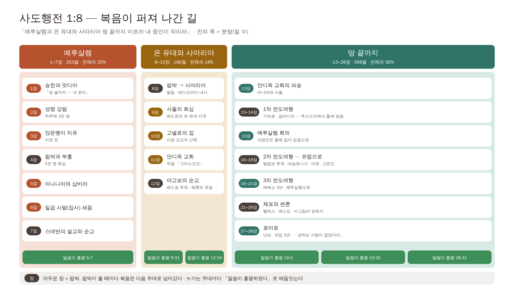

- **칸의 폭 = 분량(절 수)** — 예루살렘 1–7장 253절(25%) · 온 유대와 사마리아 8–12장 186절(18%) · **땅 끝까지 13–28장 568절(56%)**.
  사도행전의 절반 이상이 「땅 끝」, 곧 바울의 선교 이야기다. 온 유대와 사마리아는 사건은 많지만 분량은 가장 짧다.

**예루살렘 (1–7장) — 장 제목**

| 장 | 제목 | 근거 |
|---|---|---|
| 1장 | 승천과 맛디아 | 1:9 승천, 1:26 맛디아 |
| 2장 | 성령 강림 · 3천 명 | 「이 날에 제자의 수가 삼천이나 더하더라」(2:41) |
| 3장 | 앉은뱅이 치유 | 미문 앞, 「나사렛 예수 그리스도의 이름으로 걸으라」(3:6) |
| 4장 | 핍박과 부흥 · 5천 명 회심 | 베드로·요한 체포, 「남자의 수가 약 오천이나 되었더라」(4:4) |
| 5장 | 아나니아와 삽비라 | 5:1–11 (사도들의 투옥, 가말리엘의 말도 이 장) |
| 6장 | 일곱 사람(집사) 세움 | 「성령과 지혜가 충만하여 칭찬 듣는 사람 일곱을 택하라」(6:3) |
| 7장 | 스데반의 설교와 순교 | 「주 예수여, 내 영혼을 받으시옵소서」(7:59) |

**온 유대와 사마리아 → 땅 끝 (8–13장) — 선생님 정리**

- **8장** 핍박이 일어나고(「큰 핍박이 나서 … 유대와 사마리아 모든 땅으로 흩어지니라」 8:1), **사마리아로 먼저** 간다(빌립, 8:5).
- **9장** 바울 사도가 **회심**하고, **베드로의 온 유대 지역 사역**이 펼쳐진다(룻다 · 욥바, 9:32–43).
- **10장** **고넬료** 사건으로 **이방 선교의 신학**이 세워진다 — 「하나님께서 이방인에게도 생명 얻는 회개를 주셨도다」(11:18).
- **11–12장** **야고보가 순교**하는 일도 일어나고(12:2) 핍박이 있지만 **복음은 계속 전진**했다 — 「하나님의 말씀은 흥왕하여 더하더라」(12:24).
- **13장** 안디옥 교회에서 바울이 사역하다가 **선교사로 파송**된다(13:1–3).

> **검토 (2026-11-10)**
> - **안디옥 교회가 세워진 것은 11장이다.** 스데반의 일로 흩어진 이들이 안디옥에서 헬라인에게도 전했고(11:19–21), 바나바가 사울을
>   데려와 1년을 가르쳤으며, 「제자들이 안디옥에서 비로소 그리스도인이라 일컫음을 받게」 되었다(11:26). **13장은 그 교회가 바나바와
>   사울을 파송한 장**이다. → 「11장 안디옥 교회 세워짐, 13장 안디옥 교회의 파송」.
> - **「일곱 집사」**: 본문은 「일곱」 「사람」이라고만 하고 「집사」라는 직함은 쓰지 않는다(6:3, 5). 「공궤(구제)」를 맡은 일이 뒤의
>   집사직(빌 1:1, 딤전 3:8)과 이어진다고 보아 교회가 전통적으로 「일곱 집사」라 부른다. 「일곱 사람(흔히 일곱 집사)」이 정확하다.
> - 무대가 바뀔 때마다 누가가 붙이는 매듭 문장 — 「말씀이 흥왕」: 6:7 · 9:31 · 12:24 · 16:5 · 19:20 · 28:31.

### 사울의 길 — 회심에서 안디옥 파송까지 (9–13장)

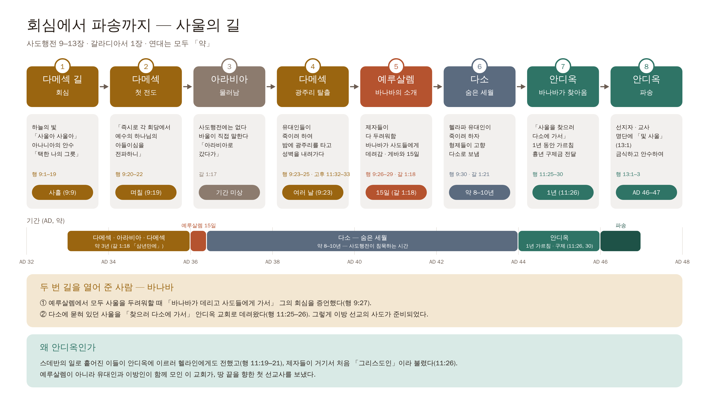

| # | 곳 | 일 | 본문 | 기간 · 때 (약) |
|---|---|---|---|---|
| 1 | 다메섹 길 | 회심 — 하늘의 빛, 아나니아의 안수, 「이 사람은 … 택한 나의 그릇이라」(9:15) | 행 9:1–19 | **사흘**(9:9) · AD 33–35 |
| 2 | 다메섹 | 첫 전도 — 「즉시로 각 회당에서 예수의 하나님의 아들이심을 전파하니」(9:20) | 행 9:20–22 | **며칠**(9:19) |
| 3 | 아라비아 | 물러남 — 사도행전에는 없고 바울이 직접 말한다: 「아라비아로 갔다가 다시 다메섹으로 돌아갔노라」 | 갈 1:17 | 기간 미상 |
| 4 | 다메섹 | 유대인들이 죽이려 하여 밤에 **광주리**로 성벽을 내려감 | 행 9:23–25 · 고후 11:32–33 | **여러 날**(9:23) |
| 5 | 예루살렘 | 제자들이 다 두려워함 → **바나바**가 사도들에게 데려감 · 게바와 15일 | 행 9:26–29 · 갈 1:18 | **15일** · 회심 3년 뒤 |
| 6 | 다소 | 헬라파 유대인이 죽이려 하자 형제들이 고향 다소로 보냄 — **숨은 세월** | 행 9:30 · 갈 1:21 | **약 8–10년** (AD 36–44) |
| 7 | 안디옥 | **바나바가 「사울을 찾으러 다소에 가서」** 데려옴 · 1년 가르침 · 흉년 구제금 전달 | 행 11:25–30 | **1년**(11:26) · AD 44–45 |
| 8 | 안디옥 | 선지자 · 교사 명단에 「및 사울」 → 금식하고 안수하여 **파송** | 행 13:1–3 | AD 46–47 |

- **기간으로 보면**: 회심 → 예루살렘까지 **약 3년**(다메섹 · 아라비아 · 다메섹, 갈 1:18 「삼년만에」) → 다소에서 **약 8–10년** → 안디옥 **1년 남짓** → 파송.
  회심에서 첫 선교 여행까지 **약 13년**이 걸렸다. 그 대부분은 사도행전이 기록하지 않은 「숨은 세월」이다.
- **두 번 길을 열어 준 사람 — 바나바**: 예루살렘에서 모두 두려워할 때 사울을 사도들에게 데려갔고(9:27), 다소에 묻혀 있던 사울을
  찾아 안디옥으로 데려왔다(11:25–26).
- **왜 안디옥인가**: 유대인과 이방인이 함께 모인 첫 교회, 「그리스도인」이라는 이름이 처음 붙은 교회가 땅 끝을 향한 첫 선교사를 보냈다.
- 원본: `scripts/bible-flow/acts-flow.py` → `out/acts-18.*`, `out/saul-path.*`

---

## 맥점 정리 — 사도행전

### 사도행전 구조의 맥점 — 행 1:8

**예루살렘과 온 유대와 사마리아, 그리고 땅 끝.** (위 「행 1:8 대로 퍼져 나간 복음」 도식)

### 오순절 성령 강림의 맥점 — 예언의 성취

**세례 요한의 예언, 예수님의 인용, 요엘 선지자를 비롯한 구약 선지자들의 예언이 오순절에 성취되었다.**

| 누가 | 말씀 | 본문 |
|---|---|---|
| **구약 선지자 — 요엘** | 「그 후에 내가 내 신을 만민에게 부어 주리니 너희 자녀들이 장래일을 말할 것이며 너희 늙은이는 꿈을 꾸며 너희 젊은이는 이상을 볼 것이며」 | 욜 2:28 |
| 구약 선지자 — 에스겔 | 「또 내 신을 너희 속에 두어 너희로 내 율례를 행하게 하리니」 | 겔 36:27 |
| 구약 선지자 — 이사야 | 「나의 신을 네 자손에게, 나의 복을 네 후손에게 내리리니」 | 사 44:3 |
| **세례 요한** | 「그는 성령과 불로 너희에게 세례를 주실 것이요」 | 눅 3:16 (마 3:11) |
| **예수님** (요한의 말을 인용) | 「요한은 물로 세례를 베풀었으나 너희는 몇 날이 못 되어 성령으로 세례를 받으리라」 | 행 1:5 |
| 예수님 (보혜사 약속) | 「그가 또 다른 보혜사를 너희에게 주사 영원토록 너희와 함께 있게 하시리니」 | 요 14:16 |
| **성취 — 오순절** | 「불의 혀같이 갈라지는 것이 … 각 사람 위에 임하여 있더니 저희가 다 성령의 충만함을 받고」 | 행 2:3–4 |
| **베드로의 해석** | 「이는 곧 선지자 요엘로 말씀하신 것이니 일렀으되 하나님이 가라사대 말세에 내가 내 영으로 모든 육체에게 부어 주리니」 | 행 2:16–17 |

- 베드로가 직접 「**이는 곧 선지자 요엘로 말씀하신 것**」(행 2:16)이라고 못 박는다 — 오순절은 갑자기 생긴 일이 아니라
  **구약 → 세례 요한 → 예수님**으로 이어진 약속이 이루어진 날이다.

### 바울 선교여행의 맥점 — 지도로 확인!

**바울의 선교여행은 지도로 봐야 한다.** 지명 이름으로만 보면 헷갈리고 무슨 말인지 모르고 한눈에 그려지지 않는다.
지도로 보면 금방 이해가 된다.

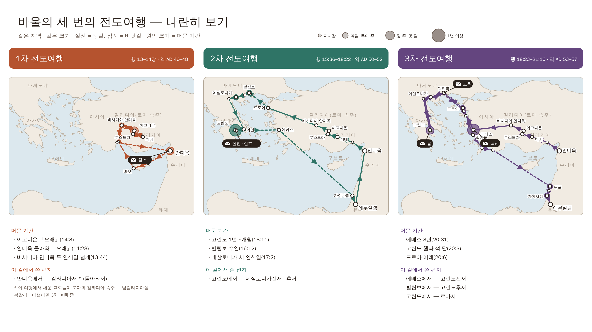

| 지도 | 파일 |
|---|---|
| 1 · 2 · 3차 나란히 보기 (같은 지역 · 같은 크기) | `out/paul-0-compare.png` |
| 1차 전도여행 — 행 13–14장 | `out/paul-1.png` |
| 2차 전도여행 — 행 15:36–18:22 | `out/paul-2.png` |
| 3차 전도여행 — 행 18:23–21:16 | `out/paul-3.png` |
| 로마로 가는 길 — 행 27–28장 | `out/paul-4-rome.png` |

- 1 · 2 · 3차 지도는 **같은 지역 · 같은 크기**로 그려 나란히 견줄 수 있다 — 1차는 소아시아 안, 2차는 바다 건너 유럽까지,
  3차는 에베소를 중심으로 같은 길을 다시 돈다.
- 실선 = 땅길, 점선 = 바닷길. 위치는 대략이고, 해안선은 공개 지도 데이터(Natural Earth)다.
- 경로 가운데 본문이 도시 이름을 다 대지 않는 구간(예: 2차의 「수리아와 길리기아로 다녀가며」 15:41, 「브루기아와 갈라디아 땅」 16:6)은
  지나갔을 법한 도시로 이었다.

### 지도 위의 표시 — 머문 기간과 쓴 편지

- **원의 크기 = 머문 기간** (지나감 · 며칠–두어 주 · 몇 주–몇 달 · 1년 이상). 오래 머문 곳: 고린도 1년 6개월(18:11) · 에베소 3년(20:31) ·
  가이사랴 2년 구금(24:27) · 로마 셋집 2년(28:30) · 멜리데 석 달(28:11) · 헬라 석 달(20:3).
- **편지 표시 = 그 길에서 그 도시에서 쓴 편지** — 오래 머문 곳에서 편지가 나왔다(고린도 → 데살로니가전후서 · 로마서, 에베소 → 고린도전서, 로마 → 옥중서신).

## 바울서신 13권 — 시기별로

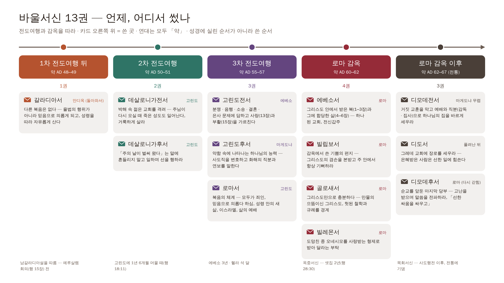

| 시기 | 때 (약) | 편지 | 쓴 곳 | 근거 |
|---|---|---|---|---|
| **1차 전도여행 뒤** | AD 48–49 | 갈라디아서 * | 안디옥 | * 남갈라디아설. 북갈라디아설이면 3차 여행 중 |
| **2차 전도여행** | AD 50–51 | 데살로니가전서 · 후서 | 고린도 | 디모데가 데살로니가에서 돌아와(살전 3:6, 행 18:5) |
| **3차 전도여행** | AD 55–57 | 고린도전서 | 에베소 | 「내가 오순절까지 에베소에 유하려 함은」(고전 16:8) |
| | | 고린도후서 | 마게도냐 | 「우리가 마게도냐에 이르렀을때에도」(고후 7:5) |
| | | 로마서 | 고린도 | 겐그레아의 뵈뵈(롬 16:1) · 헬라 석 달(행 20:2–3) |
| **로마 감옥** | AD 60–62 | 에베소서 · 빌립보서 · 골로새서 · 빌레몬서 | 로마 | 「쇠사슬에 매인 사신」(엡 6:20) · 「가이사 집 사람」(빌 4:22) · 「갇힌 자」(몬 1:9) |
| **로마 감옥 이후** (전통) | AD 62–67 | 디모데전서 | 마게도냐 무렵 | 「내가 마게도냐로 갈 때에 너를 권하여 에베소에 머물라」(딤전 1:3) |
| | | 디도서 | 풀려난 뒤 | 「니고볼리로 내게 오라 내가 거기서 과동하기로 작정하였노라」(딛 3:12) |
| | | 디모데후서 | 로마 (다시 갇힘) | 「관제와 같이 벌써 내가 부음이 되고 나의 떠날 기약이 가까왔도다」(딤후 4:6) |

- 앞에서 선생님이 정한 **교리 · 옥중 · 목회 · 교회서신** 묶음이 이 시간표 위에 그대로 놓인다 — 교회서신(데살로니가 · 고린도)은 2·3차 여행 중,
  교리서신(갈라디아 · 로마)은 1차 뒤와 3차 끝, 옥중서신은 로마 감옥, 목회서신은 로마 감옥 이후.
- 옥중서신을 쓴 곳은 로마가 전통이고, 가이사랴나 에베소로 보는 견해도 있다. 로마 감옥 이후는 사도행전 뒤의 일이라 전통에 기댄다.

### 묻고 답하기 — 갈라디아서를 1차 전도여행 때 썼다는 게 말이 되나? (2026-11-10)

**「1차 전도여행 중」이 아니라 「1차 전도여행을 마친 뒤」다.** 가 보지도 않은 곳에 먼저 편지를 쓴 것이 아니다.

- **1차 여행에서 세운 교회가 곧 갈라디아 교회다** — 비시디아 안디옥 · 이고니온 · 루스드라 · 더베는 모두 **로마의 「갈라디아 속주」** 안에 있었다.
  바울은 이 도시들에 교회를 세우고(행 13–14장) 돌아오며 장로를 세웠다(14:23).
- **그 뒤 안디옥에 돌아와서**(「거기서 배 타고 안디옥에 이르니」 14:26) 할례를 강요하는 사람들이 그 교회들을 흔든다는 소식을 듣고 쓴 것이
  갈라디아서다 — 「너희를 부르신 이를 이같이 속히 떠나 다른 복음 좇는 것을 내가 이상히 여기노라」(갈 1:6). 이 문제를 예루살렘 회의(15장)가 다룬다.
  → 이것이 **남갈라디아설**(약 AD 48–49).
- **북갈라디아설**은 「갈라디아」를 속주가 아니라 북쪽의 갈라디아 사람들 땅(지금의 앙카라 부근)으로 본다. 바울은 2차 · 3차 여행 때 그 땅을 지났으므로
  (「브루기아와 갈라디아 땅으로 다녀가」 16:6 · 「갈라디아와 브루기아 땅을 차례로 다니며」 18:23), 편지는 **3차 여행 중**(에베소나 마게도냐, 약 AD 53–57)이 된다.
- 어느 쪽이든 **세운 뒤에 썼다** — 「내가 처음에 육체의 약함을 인하여 너희에게 복음을 전한 것을 너희가 아는 바라」(갈 4:13).
- 지도의 「갈라디아」 이름표를 북쪽 빈 땅에 두었던 것이 오해를 불렀다 → **「갈라디아(로마 속주)」로 고쳐 1차 여행 도시들 곁에** 두고,
  편지 표시도 「갈라디아서 * (돌아와서)」로 고쳤다.

> **선생님 결정 (2026-11-10): 남갈라디아설을 따른다.** 갈라디아서 = 1차 전도여행을 마치고 안디옥에 돌아와 쓴 편지(약 AD 48–49), 받는 이 = 1차 여행에서
> 세운 갈라디아 속주의 교회들. 지도 · 시기별 편지 도식 · 원고(nt.cjs)를 모두 이 입장으로 맞췄다(북갈라디아설은 위 문답에만 남김).

---

## 비바울서신 9권 — 시기별로 · 쓴 곳과 받는 곳

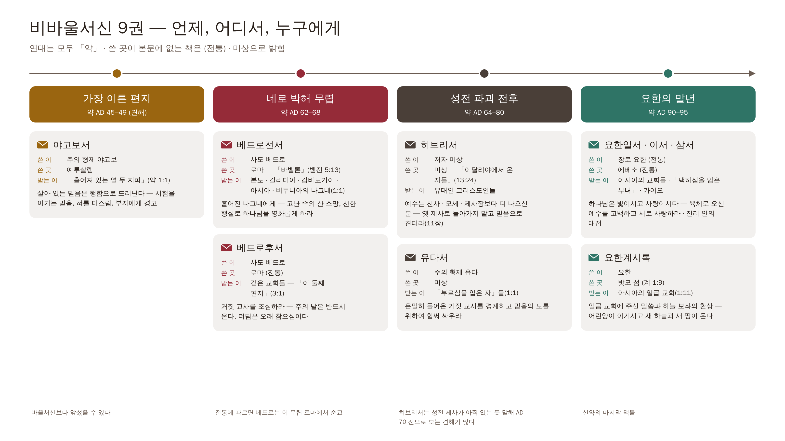

| 시기 | 때 (약) | 편지 | 쓴 이 | 쓴 곳 | 받는 이 |
|---|---|---|---|---|---|
| **가장 이른 편지** | AD 45–49 (견해) | 야고보서 | 주의 형제 야고보 | 예루살렘 | 「흩어져 있는 열 두 지파」(약 1:1) |
| **네로 박해 무렵** | AD 62–68 | 베드로전서 | 사도 베드로 | 로마 — 「바벨론」(벧전 5:13) | 본도 · 갈라디아 · 갑바도기아 · 아시아 · 비두니아의 나그네(1:1) |
| | | 베드로후서 | 사도 베드로 | 로마 (전통) | 같은 교회들 — 「이 둘째 편지」(3:1) |
| **성전 파괴 전후** | AD 64–80 | 히브리서 | 저자 미상 | 미상 — 「이달리야에서 온 자들」(13:24) | 유대인 그리스도인들 |
| | | 유다서 | 주의 형제 유다 | 미상 | 「부르심을 입은 자」들(1:1) |
| **요한의 말년** | AD 90–95 | 요한일서 · 이서 · 삼서 | 장로 요한 (전통) | 에베소 (전통) | 아시아의 교회들 · 「택하심을 입은 부녀」 · 가이오 |
| | | 요한계시록 | 요한 | 밧모 섬(계 1:9) | 아시아의 일곱 교회(1:11) |

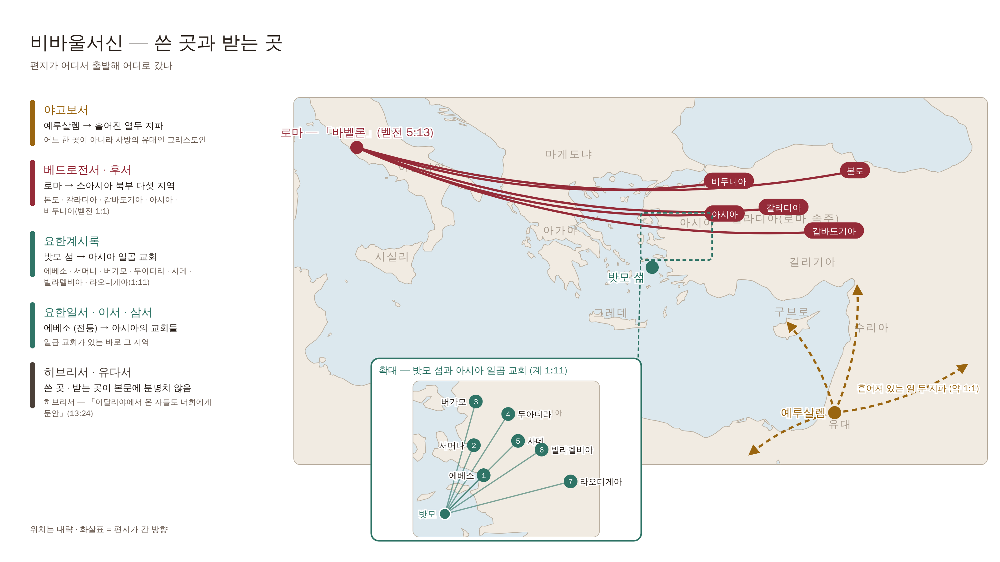

- **야고보서**는 예루살렘에서 **사방으로** 흩어진 유대인 그리스도인에게, **베드로전서**는 로마에서 **소아시아 북부 다섯 지역**으로,
  **요한계시록**은 밧모 섬에서 **바로 건너편 아시아의 일곱 교회**로 갔다(확대 지도).
- 바울서신은 대부분 **바울이 세운 교회**로 갔지만, 비바울서신은 **더 넓은 성도들**에게 갔다 — 그래서 「공동(일반)」서신이다.
- 「바벨론」을 로마로 보는 것은 교회의 오랜 해석이다(계 17–18장에서도 로마를 바벨론으로 부른다). 쓴 곳이 본문에 없는 책은 (전통) · 미상으로 밝혔다.

---

## 요한계시록 — 장별 구조와 흐름

### 장별 구조

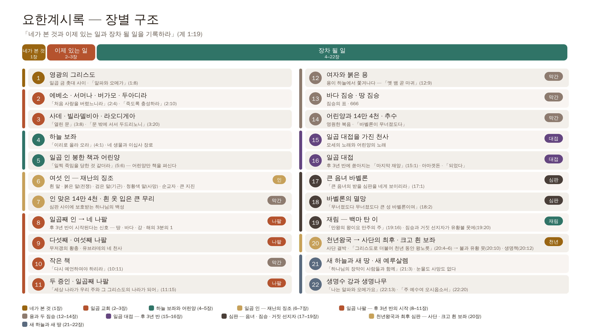

| 장 | 묶음 | 내용 |
|---|---|---|
| 1 | 네가 본 것 | 영광의 그리스도 |
| 2–3 | 이제 있는 일 — 일곱 교회 | 에베소 · 서머나 · 버가모 · 두아디라 · 사데 · 빌라델비아 · 라오디게아 |
| 4–5 | 하늘 보좌와 어린양 | 「이리로 올라 오라」(4:1) · 일곱 인 봉한 책을 어린양이 취하심 |
| 6–7 | **일곱 인 — 재난의 징조** | 네 말(전쟁 · 기근 · 사망) · 순교자 · 큰 지진 / 7장 막간: 인 맞은 14만 4천 |
| 8–11 | **일곱 나팔 — 후 3년 반이 시작된다는 신호** | 3분의 1 재앙 · 무저갱 · 두 증인 「일천 이백 육십 일」(11:3) · 일곱째 나팔(11:15) |
| 12–14 | 용과 두 짐승 (막간) | 용 = 「옛 뱀 곧 마귀」(12:9) · 짐승 「마흔 두 달」(13:5) · 666 · 추수 |
| 15–16 | **일곱 대접 — 후 3년 반에 일어날 일** | 「마지막 재앙 … 하나님의 진노가 이것으로 마치리로다」(15:1) · 아마겟돈 |
| 17–19 | **심판 — 음녀 · 적그리스도 · 거짓 선지자** | 음녀 바벨론(17–18장) → 재림(19:11–16) → 짐승과 거짓 선지자 유황불 못(19:20) |
| 20 | **천년왕국과 최후 심판** | 사단 천 년 결박 · 「첫째 부활」 · 「그리스도로 더불어 천년 동안 왕노릇」(20:4–6) → 천 년 뒤 사단이 놓였다가 불과 유황 못(20:7–10) → 크고 흰 보좌 · 생명책(20:11–15) |
| 21–22 | 새 하늘과 새 땅 | 새 예루살렘 · 생명수 강과 생명나무 |

> **선생님 정리 (2026-11-10)**: 7인은 **재난의 징조**들이고, 7나팔은 **후 3년 반의 재난이 시작된다는 사인**이고, 7대접이 **후 3년 반에 일어날 일**들이다.
> 결국은 **거짓 선지자와 음녀, 적그리스도와 사단이 심판을 받는** 내용이다.

### 마태복음 24장의 흐름으로 — 다니엘서와 함께

**요한계시록은 마태복음 24장 예수님의 종말 강화와 연결된다 — 재난의 징조 → 대환난 → 재림 → 휴거 → (천년왕국) → 심판의 흐름을 갖고 있다.**

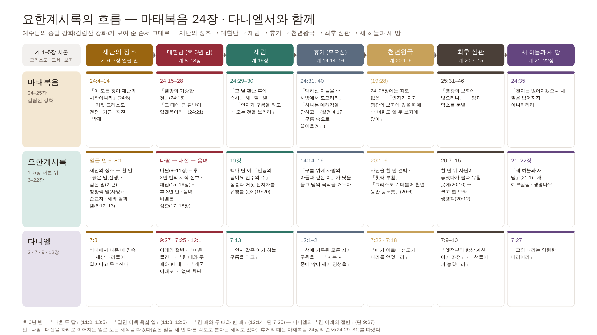

| 흐름 | 마태복음 24–25장 | 요한계시록 | 다니엘 |
|---|---|---|---|
| **재난의 징조** | 「이 모든 것이 재난의 시작이니라」(24:8) | 일곱 인(6–8:1) — 전쟁 · 기근 · 사망 · 해와 달과 별(6:12–13) | 네 짐승 — 나라들의 흥망(7:3) |
| **대환난 (후 3년 반)** | 「멸망의 가증한 것」(24:15) · 「큰 환난」(24:21) | 일곱 나팔(8–11장) → 일곱 대접(15–16장) · 짐승 「마흔 두 달」(13:5) | 「이레의 절반」 · 「미운 물건」(9:27) · 「한 때와 두 때와 반 때」(7:25) · 「없던 환난」(12:1) |
| **재림** | 「인자가 구름을 타고 … 오는 것을 보리라」(24:30) | 백마 탄 이 「만왕의 왕」(19:11–16) · 「구름을 타고 오시리라」(1:7) | 「인자 같은 이가 하늘 구름을 타고」(7:13) |
| **휴거 (모으심)** | 「택하신 자들을 … 사방에서 모으리라」(24:31) · 「하나는 데려감을」(24:40) | 「구름 위에 사람의 아들과 같은 이」의 추수(14:14–16) | 「자는 자 중에 많이 깨어 영생을」(12:2) |
| **천년왕국** | (24–25장에는 따로 없음 — 「너희도 열 두 보좌에 앉아」 19:28) | 사단 결박 · 첫째 부활 · 「그리스도로 더불어 천년 동안 왕노릇」(20:1–6) | 「때가 이르매 성도가 나라를 얻었더라」(7:22) |
| **최후 심판** | 「영광의 보좌」 · 양과 염소(25:31–46) | 사단이 불과 유황 못에(20:10) → 크고 흰 보좌 · 생명책(20:11–15) | 「책들이 펴 놓였더라」(7:10) |
| **새 하늘과 새 땅** | 「천지는 없어지겠으나 내 말은 없어지지 아니하리라」(24:35) | 새 하늘과 새 땅 · 새 예루살렘(21–22장) | 「그의 나라는 영원한 나라」(7:27) |

- **다니엘이 열쇠다** — 예수님이 직접 「선지자 다니엘의 말한 바 멸망의 가증한 것」(마 24:15)이라고 다니엘을 인용하신다.
- **후 3년 반 = 같은 기간의 네 가지 이름**: 「마흔 두 달」(계 11:2, 13:5) = 「일천 이백 육십 일」(계 11:3, 12:6) = 「한 때와 두 때와 반 때」(계 12:14 · 단 7:25) = 「한 이레의 절반」(단 9:27).
- 계시록의 짐승(13장)은 다니엘의 넷째 짐승과 그 뿔(단 7장)을, 「인자 같은 이」(계 1:13, 14:14)는 단 7:13 을 그대로 잇는다.

> **해석에 대해 (수강생이 물을 수 있는 것)**: 인 · 나팔 · 대접을 **차례로 이어지는 일**로 보는 해석을 따랐다(같은 일을 세 번 다른 각도로 본다는 해석도 있다).
> 휴거의 때(환난 전 · 중 · 후)도 견해가 갈린다 — 이 정리는 마태복음 24장의 순서(「그 날 환난 후에」 24:29 → 인자가 오심 → 택하신 자들을 모으심 24:31)를 따랐다.
> 천년왕국도 재림 뒤 문자적 천 년(전천년설)으로 보는 견해, 교회 시대 전체를 상징한다는 견해(무천년설 · 후천년설)가 있다 — 이 정리는 계 19장(재림) → 20장(천 년)의 순서대로 놓았다.

### 성경 전체와의 연결 — 창세기와 맞물리는 끝

| 창세기 (처음) | 요한계시록 (끝) |
|---|---|
| 하늘과 땅을 지으심(창 1:1) | 새 하늘과 새 땅(계 21:1) |
| 에덴 동산(창 2:8) | 하늘에서 내려오는 새 예루살렘(계 21:2) |
| 뱀이 들어와 속임(창 3:1) | 「옛 뱀 곧 마귀」가 쫓겨나고 심판받음(계 12:9, 20:10) |
| 저주가 들어옴(창 3:17) | 「다시 저주가 없으며」(계 22:3) |
| 생명나무에서 쫓겨남(창 3:24) | 생명나무가 다시 있음(계 22:2) |
| 동산에 거니시는 하나님 앞에서 사람이 숨음(창 3:8) | 「하나님의 장막이 사람들과 함께」(계 21:3) |

- 요한계시록은 **성경 전체의 결론**이다 — 창세기에서 시작된 이야기가 여기서 닫히고, 마태복음 24장 · 다니엘서의 예언이 한자리에 모인다.

---

## 다시 보기 — 로마의 세 시대 (왕정 · 공화정 · 제정)

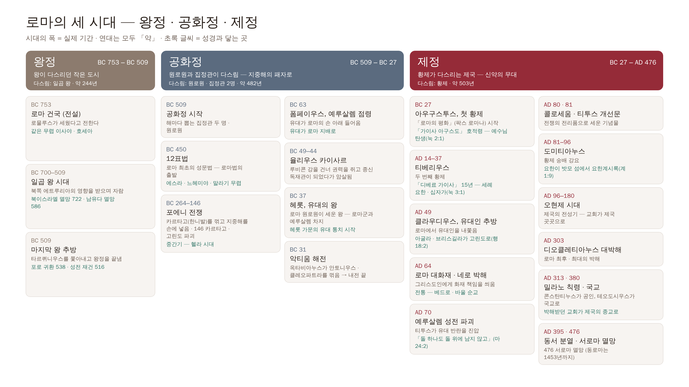

| 시대 | 때 | 다스림 | 가장 중요한 사건 | 성경과 닿는 곳 |
|---|---|---|---|---|
| **왕정** | BC 753 – 509 (약 244년) | 일곱 왕 | 로마 건국(전설, 753) · 일곱 왕 시대 · 마지막 왕 추방(509) | 이사야 · 호세아 무렵 → 북이스라엘 멸망(722) · 남유다 멸망(586) · 포로 귀환(538) |
| **공화정** | BC 509 – 27 (약 482년) | 원로원 · 집정관 2명 | 12표법(450) · **포에니 전쟁**(264–146, 지중해 장악) · **폼페이우스 예루살렘 점령**(63) · 카이사르(49–44) · **헤롯, 유대의 왕**(37) · 악티움 해전(31) | 에스라 · 느헤미야 · 말라기 → 중간기 → 유대가 로마 손 아래로 |
| **제정** | BC 27 – AD 476 (약 503년) | 황제 | **아우구스투스 첫 황제**(27) · 티베리우스 · 클라우디우스 유대인 추방(49) · **네로 박해**(64) · **예루살렘 성전 파괴**(70) · 콜로세움 · 개선문(80 · 81) · 도미티아누스 · 오현제 · 대박해(303) · **밀라노 칙령**(313) · 국교(380) · 동서 분열(395) · 서로마 멸망(476) | 예수님 탄생(눅 2:1) · 십자가(눅 3:1) · 사도행전 · 서신서 · 요한계시록 — **신약 전체가 제정 초기 약 100년 안에** |

- 한 줄로: **구약 후반은 왕정 · 공화정 시대와 겹치고, 신약은 제정 초기에 들어 있다.**
- 원본: `scripts/bible-flow/rome-periods.py` → `out/rome-periods.*`

---

## 로마 황제들의 왕조

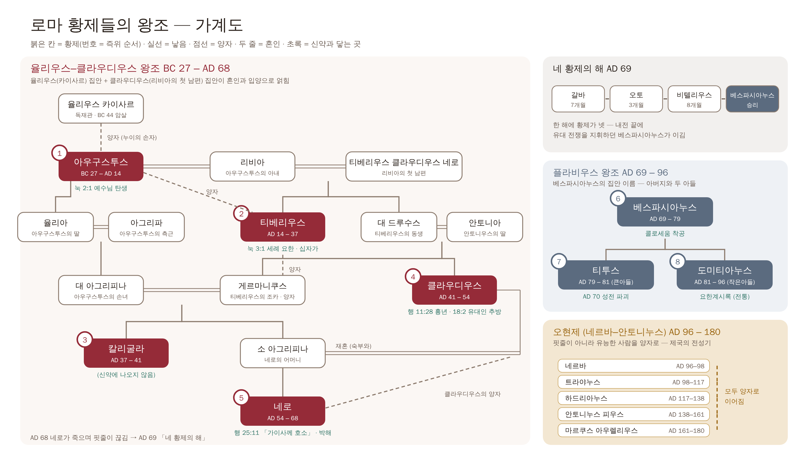

- 원본: `scripts/bible-flow/rome-dynasty.py` · 붉은 칸 = 황제(번호 = 즉위 순서) · 실선 = 낳음 · 점선 = 양자 · 두 줄 = 혼인

### 율리우스–클라우디우스 왕조 (BC 27 – AD 68) — 신약의 대부분

**두 집안의 이름을 합친 것이다.**

- **율리우스 집안** — 율리우스 카이사르의 집안. 카이사르가 조카의 아들 **옥타비아누스를 양자**로 삼았다 → 그가 첫 황제 **아우구스투스**.
- **클라우디우스 집안** — 아우구스투스의 아내 **리비아**가 첫 남편(클라우디우스 집안)에게서 낳은 아들이 **티베리우스**다. 아우구스투스가 그를 양자로 삼아 후계자로 세웠다.
- 그 뒤 황제들은 두 집안의 피와 입양으로 얽혀 이어진다 — 그래서 「율리우스–클라우디우스」.

| 황제 | 다스린 때 | 두 집안과의 관계 | 신약에서 |
|---|---|---|---|
| **아우구스투스** | BC 27 – AD 14 | 율리우스 (카이사르의 양자) | 「가이사 아구스도」 — 예수님 탄생(눅 2:1) |
| **티베리우스** | AD 14 – 37 | 클라우디우스 (리비아의 아들, 아우구스투스의 양자) | 「디베료 가이사」 — 세례 요한 · 십자가(눅 3:1) |
| 칼리굴라 | AD 37 – 41 | 아우구스투스의 증손 · 티베리우스의 조카 손자 | 나오지 않음 |
| **클라우디우스** | AD 41 – 54 | 클라우디우스 (티베리우스의 조카) | 「글라우디오」 — 흉년(행 11:28), 유대인 추방(행 18:2) |
| **네로** | AD 54 – 68 | 아우구스투스의 고손 · 클라우디우스의 양자 | 바울의 「가이사께 호소」(행 25:11) · 박해 · 베드로와 바울 순교(전통) |

- 네로가 반란 속에 스스로 목숨을 끊으며(AD 68) **이 집안의 핏줄이 끊긴다.**

### 네 황제의 해 (AD 69)

갈바 → 오토 → 비텔리우스 → **베스파시아누스**. 한 해에 황제가 넷 바뀐 내전. 마지막에 유대 전쟁을 지휘하던 베스파시아누스가 이긴다.

### 플라비우스 왕조 (AD 69 – 96) — 성전 파괴와 요한계시록

**베스파시아누스의 집안 이름(플라비우스)**에서 왔다. 아버지와 두 아들의 왕조.

| 황제 | 다스린 때 | 성경과 닿는 곳 |
|---|---|---|
| **베스파시아누스** | AD 69 – 79 | 유대 전쟁 지휘 → 황제가 됨 · 콜로세움 착공 |
| **티투스** (큰아들) | AD 79 – 81 | 장군 때 **AD 70 예루살렘 성전 파괴** · 콜로세움 완공(80) |
| **도미티아누스** (작은아들) | AD 81 – 96 | 형을 기려 **티투스 개선문** · 황제 숭배 강요 · 요한의 밧모 섬 유배와 **요한계시록**(전통) |

### 그 뒤 — 오현제 (네르바–안토니누스 왕조, AD 96 – 180)

네르바 · 트라야누스 · 하드리아누스 · 안토니누스 피우스 · 마르쿠스 아우렐리우스. **핏줄이 아니라 유능한 사람을 양자로 세워** 물려준 것이 특징 — 제국의 전성기. 신약이 다 쓰인 뒤, 교회가 제국 곳곳으로 퍼지던 때다.

### 한 줄로

**신약의 복음서 · 사도행전 · 바울서신은 율리우스–클라우디우스 왕조, 성전 파괴와 요한계시록은 플라비우스 왕조 때의 일이다.**

---

## 요한계시록의 맥점 — 다니엘서의 봉인된 두루마리가 열린다

**요한계시록의 맥점은 다니엘서에 나오는 봉인된 그 두루마리가 요한계시록이라는 점이다.**

| | 다니엘 — 봉하라 | 요한계시록 — 떼신다 · 봉하지 말라 |
|---|---|---|
| 명령 | 「다니엘아 마지막 때까지 이 말을 간수하고 이 글을 **봉함하라**」(단 12:4) | 「이 책의 예언의 말씀을 **인봉하지 말라** 때가 가까우니라」(계 22:10) |
| 깨닫지 못함 / 울음 | 「내가 듣고도 깨닫지 못한지라 … 이 모든 일의 결국이 어떠하겠삽나이까」(단 12:8) | 책을 펼 자가 없어 요한이 울자 — 「울지 말라 … 이 책과 그 일곱인을 떼시리라」(계 5:5) |
| 언제까지 | 「이 말은 **마지막 때까지** 간수하고 봉함할 것임이니라」(단 12:9) | 「**때가 가까우니라**」(계 22:10) |
| 책 | 봉함된 글 | 「보좌에 앉으신 이의 오른손에 책이 있으니 안팎으로 썼고 **일곱 인으로 봉하였더라**」(계 5:1) |
| 누가 여나 | — | **죽임당한 어린양** — 「책을 가지시고 그 인봉을 떼기에 합당하시도다 일찍 죽임을 당하사」(계 5:9) |
| 그 뒤 | — | 「어린 양이 일곱 인 중에 하나를 떼시는 그 때에」(계 6:1) → 6장부터 「장차 될 일」이 펼쳐진다 |

- **다니엘이 봉한 것을 어린양이 연다** — 그래서 요한계시록은 다니엘서와 함께 읽어야 한다. 계시록 6장 이후의 일곱 인 · 나팔 · 대접이
  봉인이 하나씩 떼어지며 드러나는 「마지막 때」의 일이다.
- 다니엘은 봉하라는 말을, 요한은 **봉하지 말라**는 말을 듣는다 — 같은 이야기의 처음과 끝이다.

> 덧붙임: 다니엘 12장의 봉함된 글과 계시록 5장의 일곱 인 봉한 책을 **같은 책으로 보는 것은 해석**이다(본문이 「이것이 그 책이다」라고
> 직접 말하지는 않는다). 다만 「봉하라」(단 12:4, 9) ↔ 「봉하지 말라」(계 22:10)의 대조는 본문에 분명하다.

### 선생님 정리 — 요한계시록은 열린 두루마리의 내용이다

요한은 5장에서 **천상에서 예수님께서 받으신 두루마리**를 보고(「어린 양이 나아와서 보좌에 앉으신 이의 오른손에서 책을 취하시니라」 5:7),
그것을 **떼시는 장면을 목격한다.** 일곱 인을 떼시고, 일곱 나팔을 불고, 일곱 대접이 쏟아지게 된다.

**그래서 요한계시록의 내용은 천상에서 봉인되었던 두루마리를 예수님께서 떼서 그 내용을 보여 주시는 것이다. — 이것이 맥점.**

```
4장  하늘 보좌 — 「이리로 올라 오라」
5장  봉인된 두루마리 → 어린양(예수님)이 받으심
6장~ 인을 떼심 ── 일곱 인 (재난의 징조)
                    └ 일곱째 인(8:1) → 일곱 나팔 (후 3년 반의 시작 신호)
                                         └ 일곱째 나팔(11:15) → … 일곱 대접 (후 3년 반 · 15–16장)
                                                                   → 심판 · 천년왕국 · 새 하늘과 새 땅
```

- 일곱째 인을 떼자 일곱 나팔이 나오고(8:1–2), 일곱째 나팔 뒤에 마지막 재앙인 일곱 대접이 이어진다(11:15, 15:1) — 두루마리가 한 겹씩 펼쳐지는 모양이다.

### 선생님 정리 — 구원의 경륜이 완성되기까지

**그래서 7인은 재난의 징조가 되고, 7나팔은 재난의 시작이 되고, 7대접은 재난의 내용이 된다.**
**그리고 그 뒤로 주님의 재림과 심판, 천년왕국, 백보좌 심판과 새 하늘과 새 땅으로 하나님의 구원의 경륜이 완성된다.**

| 순서 | 무엇 | 요한계시록 |
|---|---|---|
| 1 | **7인 — 재난의 징조** | 6–8:1 |
| 2 | **7나팔 — 재난의 시작** | 8:2–11장 |
| 3 | **7대접 — 재난의 내용** | 15–16장 |
| 4 | **주님의 재림** | 19:11–16 |
| 5 | **심판** — 음녀 바벨론 · 짐승(적그리스도)과 거짓 선지자 | 17–18장 · 19:20 |
| 6 | **천년왕국** — 사단 결박 · 그리스도와 함께 왕 노릇 | 20:1–6 |
| 7 | **백보좌 심판** — 사단의 최후 · 생명책 | 20:7–15 |
| 8 | **새 하늘과 새 땅** — 하나님의 구원의 경륜이 완성됨 | 21–22장 |

---

## 일곱 교회의 환상 (계 1–3장)

### 1. 환상 — 일곱 금 촛대 사이의 그리스도 (1:9–20)

밧모 섬에서 요한이 뒤를 돌아보니 「일곱 금촛대를 보았는데 촛대 사이에 인자 같은 이가」(1:12–13) 서 계셨다.
「그 오른손에 일곱 별이 있고 그 입에서 좌우에 날선 검이 나오고」(1:16). 요한이 죽은 자같이 엎드리자 「두려워 말라 나는 처음이요 나중이니
곧 산 자라 내가 전에 죽었었노라 볼지어다 이제 세세토록 살아 있어」(1:17–18).

예수님이 직접 풀어 주신다 — **「일곱 별은 일곱 교회의 사자요 일곱 촛대는 일곱 교회니라」(1:20)**.

→ **이 환상의 뜻: 영광의 그리스도께서 교회들 한가운데를 다니시며 교회를 붙들고 계신다.** 핍박받는 교회에게 「주님이 너희 가운데 계신다」는 것이
계시록의 첫 장면이다. 하늘 보좌(4장)와 두루마리(5장)를 보기 전에, 먼저 **땅의 교회를 살피시는 주님**을 본다.

### 2. 일곱 편지 — 모두 같은 틀

각 편지는 **1장 환상 속 그리스도의 모습 하나**로 시작해 → 칭찬 → 책망 → 권면 → 「귀 있는 자는 성령이 교회들에게 하시는 말씀을 들을지어다」 →
**이기는 자에게 주시는 약속**으로 끝난다.

| 교회 | 그리스도의 모습 (1장에서) | 칭찬 | 책망 | 이기는 자에게 |
|---|---|---|---|---|
| **에베소** | 「일곱 별을 붙잡고 일곱 금촛대 사이에 다니시는 이」(2:1) | 수고 · 인내 · 거짓 사도를 드러냄(2:2) | 「처음 사랑을 버렸느니라」(2:4) | 생명나무의 과실(2:7) |
| **서머나** | 「처음이요 나중이요 죽었다가 살아나신 이」(2:8) | 「환난과 궁핍 … 실상은 네가 부요한 자」(2:9) | **없음** — 「죽도록 충성하라」(2:10) | 둘째 사망의 해를 받지 않음(2:11) |
| **버가모** | 「좌우에 날선 검을 가진 이」(2:12) | 「사단의 위가 있는 데」서도 믿음을 지킴(2:13) | 발람의 교훈 · 우상의 제물(2:14) | 감추었던 만나 · 흰 돌 · 새 이름(2:17) |
| **두아디라** | 「그 눈이 불꽃 같고 … 하나님의 아들」(2:18) | 「나중 행위가 처음 것보다 많도다」(2:19) | 「여자 이세벨을 네가 용납함」(2:20) | 만국을 다스리는 권세(2:26) |
| **사데** | 「하나님의 일곱 영과 일곱 별을 가진 이」(3:1) | 옷을 더럽히지 않은 「몇 명」(3:4) | 「살았다 하는 이름은 가졌으나 죽은 자로다」(3:1) | 흰 옷 · 생명책에서 지우지 않음(3:5) |
| **빌라델비아** | 「다윗의 열쇠를 가지신 이」(3:7) | 「적은 능력을 가지고도 내 말을 지키며」(3:8) | **없음** — 「열린 문」(3:8) | 하나님 성전의 기둥 · 새 예루살렘의 이름(3:12) |
| **라오디게아** | 「아멘이시요 충성되고 참된 증인」(3:14) | **없음** | 「차지도 아니하고 더웁지도 아니하도다」(3:15) · 「나는 부자라」(3:17) | 「내 보좌에 함께 앉게」(3:21) |

- **책망이 없는 교회는 둘**(서머나 · 빌라델비아), **칭찬이 없는 교회는 하나**(라오디게아).
- 이기는 자에게 주시는 약속들(생명나무 · 새 이름 · 흰 옷 · 생명책 · 새 예루살렘 · 보좌)이 **계시록 끝 21–22장에서 그대로 이루어진다** — 첫 장면과 마지막 장면이 맞물린다.

### 3. 일곱 교회를 어떻게 볼까 (견해)

1. **실제 교회** — 1세기 아시아(지금의 튀르키예 서부)에 실제로 있던 일곱 교회. 순회 길을 따라 에베소에서 라오디게아까지 차례로 놓여 있다.
2. **모든 시대 교회의 모습** — 「성령이 **교회들**에게 하시는 말씀」(2:7 등 일곱 번)이라 복수로 말한다. 어느 시대든 이 일곱 모습의 교회가 있다.
3. **교회 역사의 일곱 시대** — 에베소(사도 시대)에서 라오디게아(마지막 시대)까지 교회사의 흐름으로 읽는 견해도 있다.

→ 맥잡기에서는 1과 2를 함께 붙잡는다 — **실제 교회에 보낸 편지이면서, 지금 우리 교회에 주시는 말씀**이다.

### 도식 — 일곱 교회의 환상과 편지

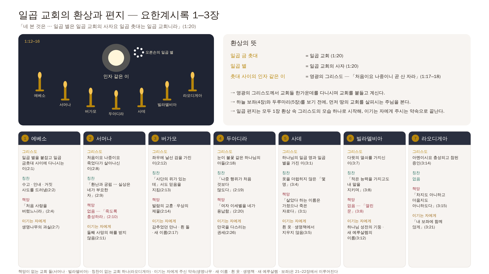

---

# 지금까지의 맥점 — 신약 (2026-11-10 정리)

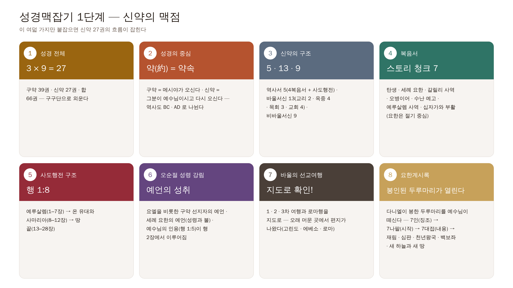

| # | 어디 | 맥점 | 한 줄 |
|---|---|---|---|
| 1 | 성경 전체 | **3 × 9 = 27** | 구약 39권 · 신약 27권 · 합 66권 — 구구단으로 외운다 (성경공부의 첫 번째 맥) |
| 2 | 성경의 중심 | **약(約) = 약속** | 구약은 메시야가 오신다는 약속, 신약은 그분이 예수님이시고 십자가 · 부활 · 다시 오심의 약속 — 역사도 그분으로 BC · AD 가 나뉜다 |
| 3 | 신약의 구조 | **5 · 13 · 9** | 역사서 5(4복음서 + 사도행전) · 바울서신 13(교리 2 · 옥중 4 · 목회 3 · 교회 4) · 비바울서신 9 — 「이게 전부다」 |
| 4 | 복음서 | **스토리 청크 7** | 탄생 · 세례 요한 · 갈릴리 사역 · 오병이어 · 수난 예고 · 예루살렘 사역 · 십자가와 부활 — 공관복음은 같은 관점, 요한은 절기 중심 |
| 5 | 사도행전 구조 | **행 1:8** | 예루살렘 → 온 유대와 사마리아 → 땅 끝 |
| 6 | 오순절 성령 강림 | **예언의 성취** | 요엘을 비롯한 구약 선지자 · 세례 요한 · 예수님의 인용이 행 2장에서 이루어짐 |
| 7 | 바울의 선교여행 | **지도로 확인!** | 지명만 보면 헷갈린다 — 지도로 보면 한눈에 그려진다 |
| 8 | 요한계시록 | **봉인된 두루마리가 열린다** | 다니엘서의 봉인된 두루마리를 예수님이 떼어 보여 주신다 — 7인(재난의 징조) → 7나팔(재난의 시작) → 7대접(재난의 내용) → 재림 · 심판 · 천년왕국 · 백보좌 심판 · 새 하늘과 새 땅으로 구원의 경륜이 완성 |

**맥점을 받쳐 주는 배경 자료** (이 문서 안)

- 로마의 세 시대 · 황제 왕조 가계도 · 로마 역사 속 신약 시대 도식
- 누가복음 3장 일곱 통치자로 본 시대 · 헤롯 가문과 로마 · AD 70 · 티투스 개선문 · 콜로세움
- 신약이 쓰인 순서 · 바울서신과 비바울서신 시기별 도식 · 쓴 곳과 받는 곳 지도
- 사울의 길(회심에서 파송까지) · 마태복음 24장 · 다니엘과 함께 본 요한계시록의 흐름 · 일곱 교회
